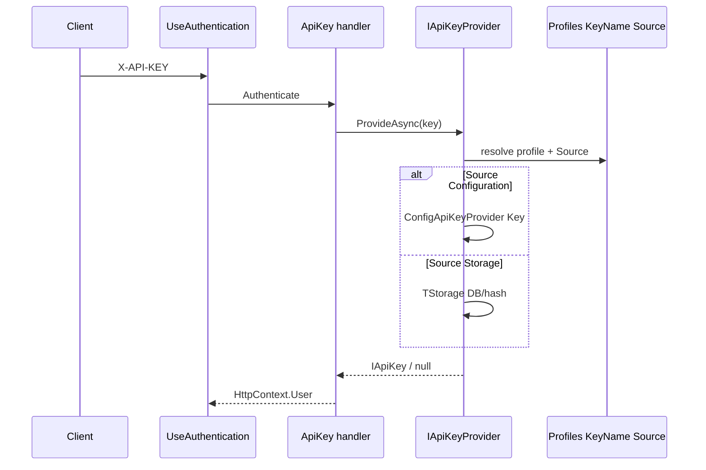

# Platform Authentication — tổng quan

Platform Authentication **không thay** mô hình [ASP.NET Core Authentication](https://learn.microsoft.com/en-us/aspnet/core/security/authentication/). Nó **orchestrate** từ `appsettings`: bật handler, chọn profile, map `AuthenticationOptions`, và cung cấp extension `AddCore*` + contract provider cho secret/credential.

**Phân tách rõ:**

| Tầng | Trách nhiệm | Package / module |
|------|-------------|------------------|
| **Authentication (AuthN)** | *Ai* đang gọi API? Credential hợp lệ? | `Platform.Authentication.*` |
| **Authorization (AuthZ)** | *Được làm gì?* Policy, RBAC/ABAC | `Platform.Authorization.*` |
| **Current user** | Profile đầy đủ sau AuthN (store, tenant, …) | `Platform.Authentication` + `ICurrentUserStore` |

Chi tiết AuthZ: [ADR RBAC+ABAC](../../ADRs/2026-08-14_platform_rbac-abac-authorization.md). Current user: [current-user.md](./current-user.md).

---

## Kiến trúc package

```text
Platform.Authentication              # Root options, AddPlatformAuthentication, scheme resolution, password policy, CurrentUser
├── Platform.Authentication.Jwt      # AddCoreJwtBearer, AuthenticationJwtOption
├── Platform.Authentication.ApiKey   # AddCoreApiKey*, ConfigApiKeyProvider, ProfileSourcedApiKeyProvider
├── Platform.Authentication.Basic    # AddCoreBasic*, IBasicCredentialProvider
├── Platform.Authentication.Identity # Identity integration (User, stores)
└── Platform.Authentication.Cognito  # Admin SDK stub / tích hợp Cognito (tùy host)

Platform.Modules.Account           # Login → phát JWT (Identity UserManager) — không thay JwtBearer middleware
```

**Entry point host:**

```csharp
services.AddPlatformAuthentication(configuration, auth =>
{
    // auth.AddCoreJwtBearer / AddCoreApiKey* / AddCoreBasic* theo Authentication:Schemes:*:Enabled
});
```

`AddPlatformAuthentication`:

- Bind `AuthenticationRootOptions` từ section `Authentication`, `ValidateOnStart`
- Map `Default*Scheme` → `AuthenticationOptions` (`AuthenticationSchemeResolution.ApplyTo`)
- Đăng ký `IPasswordPolicyValidator`, placeholder `IPasswordPolicyProvider` / `IPasswordPolicyScopeProvider`
- Đăng ký `IConfiguration` vào DI (cho provider đọc profile)

Host (vd. Sample) gọi `AddCore*` trong callback `configureSchemes` — Platform **không** tự bật Jwt/ApiKey/Basic chỉ từ flag; Sample đọc `Enabled` và đăng ký tương ứng.

---

## Cấu hình `Authentication` trong appsettings

| Nhánh | Mục đích |
|-------|----------|
| `DefaultScheme`, `DefaultAuthenticateScheme`, `DefaultChallengeScheme`, `DefaultSignInScheme`, `DefaultSignOutScheme`, `DefaultForbidScheme`, `RequireAuthenticatedSignIn` | Map 1:1 `Microsoft.AspNetCore.Authentication.AuthenticationOptions` |
| `Schemes:{Kind}` | `Enabled`, `Profile` (profile **active**), `Profiles:{name}` (chi tiết từng profile) |
| `PasswordPolicy` | `Source` + `Defaults` — độ mạnh mật khẩu (đăng ký/đổi mật khẩu) |

Chi tiết JSON và bảng field: [appsettings.md](./appsettings.md).

### Tên scheme chuẩn (`PlatformAuthenticationSchemes`)

| Kind | Tên scheme ASP.NET Core | Ghi chú |
|------|-------------------------|---------|
| JWT | `Bearer` | `JwtBearerHandler` |
| HTTP Basic | `Basic` | `PlatformBasicAuthenticationHandler` |
| ApiKey | `ApiKey` | Profile (`Default`, `Integration`, …) dưới `Schemes:ApiKey:Profiles`; realm / `DefaultRealm` = tên profile |

`DefaultAuthenticateScheme` / `DefaultChallengeScheme` phải trùng scheme **đã đăng ký** và `Schemes.*.Enabled = true` (validator startup).

---

## `Source`: Configuration vs Storage

`AuthenticationCredentialSource` (trong từng **profile**, không ở cấp scheme):

| `Source` | Ý nghĩa |
|----------|---------|
| `Configuration` | Secret / user / signing key trong config (`Key`, `Users`, `IssuerSigningKeys`, …) — test, dev, integration profile |
| `Storage` | Host đăng ký provider tra DB/vault (`IApiKeyProvider`, `IBasicCredentialProvider`, …) |

**Luôn trong config (hành vi scheme):** `KeyName`, `Realm`, flag validate JWT, … — không chứa production secret khi `Source = Storage`.

| Kind | Routing theo profile |
|------|----------------------|
| **ApiKey** | `AddCoreApiKeyWithProfileSources<TStorage>` — header `profile:secret` hoặc secret thuần → profile `Default` / `Schemes.ApiKey.Profile` |
| **Basic** | `AddCoreBasicWithProfileSources<TStorage>` — theo profile **active** `Schemes.Basic.Profile` |
| **Bearer** | `Source` bind trên option; **chưa** có router storage. `AddCoreJwtBearer` luôn đọc profile từ config. Sample từ chối `Source = Storage`. |

Storage-backed credential, bảng Sample, tenant header: [storage-backed-providers.md](./storage-backed-providers.md).

---

## Luồng runtime theo scheme

### ApiKey (mỗi request)



### HTTP Basic (mỗi request)

1. Header `Authorization: Basic …`
2. `PlatformBasicAuthenticationHandler` → `IBasicCredentialProvider`
3. Profile-sourced: config `Users` hoặc storage (Sample: `BasicAuthUser` + tenant)

Realm challenge 401: `AuthenticationBasicOption.Realm` của profile active (bind lên scheme name `Basic`).

### JWT Bearer — hai luồng tách biệt

**Quan trọng:** phát token (login) và validate token (API) dùng **cùng profile config** `Authentication:Schemes:Bearer:Profiles:{Profile}` cho **ký/validate**, nhưng **không** gộp thành một middleware.

| Luồng | Khi chạy | Code điển hình | Dữ liệu user |
|-------|----------|----------------|--------------|
| **(1) Tạo access token** | Endpoint login sau khi xác thực username/password | `LoginCommandHandler` (`Platform.Modules.Account`) | **Identity** `UserManager` → store host (Sample: **DB**) — **không** do `Bearer:Source` quyết định |
| **(2) Validate từng request** | `UseAuthentication` + `[Authorize]` với scheme `Bearer` | `AddCoreJwtBearer` → `JwtBearerHandler` | Chỉ đọc JWT + claims; không query user DB trừ khi app tự gọi `ICurrentUser` |

**Luồng (1) — Configuration (symmetric, implementation hiện tại):**

- Sau `UserManager` OK → `IOptionsMonitor<AuthenticationJwtOption>("Bearer")`
- Ký bằng `IssuerSigningKeys[0]`, issuer/audience/lifetime từ cùng option
- **Không** dùng `Authority` để phát token; thiếu key → lỗi *JWT signing key not configured*

**Luồng (2) — Configuration:**

- Có `Authority` → validate qua OIDC metadata (public keys IdP)
- Không `Authority` → validate symmetric bằng `IssuerSigningKeys` + flag `ValidateIssuer` / `ValidateAudience` / …

Hai luồng symmetric phải **cùng key/issuer/audience** trong profile (hoặc login và API sẽ lệch).

Token từ **IdP bên ngoài** → thường chỉ có luồng (2); app không dùng `LoginCommandHandler` để ký.

---

## Password policy

Tách khỏi scheme ApiKey/Basic/Bearer — áp dụng khi đăng ký/đổi mật khẩu:

| `PasswordPolicy:Source` | Hành vi |
|-------------------------|---------|
| *(không set)* | Rule mặc định của `PasswordPolicyOptions` (MinLength 8, …) |
| `Configuration` | `PasswordPolicy:Defaults` trong appsettings |
| `Storage` | `IPasswordPolicyProvider` bắt buộc (startup fail nếu chỉ `NullPasswordPolicyProvider`); runtime null từ storage → lỗi |

`IPasswordPolicyValidator` (`PlatformPasswordPolicyValidator`) gọi từ flow host (OpenIddict/Identity tương lai). Sample: `TenantPasswordPolicy` + `Source: Storage`.

---

## Sau khi authenticate: Current user

Middleware gắn `HttpContext.User` (claims). Application dùng `ICurrentUser<TUser>.GetAsync()`:

1. Ambient (`ICurrentUserAccessor`)
2. Claim `sub` / `NameIdentifier`
3. `ICurrentUserStore.FindAsync`

Xem [current-user.md](./current-user.md).

---

## Đăng ký extension (host)

| Mục đích | API |
|----------|-----|
| Chỉ config (test) | `AddCoreApiKey<ConfigApiKeyProvider>`, `AddCoreBasic<ConfigBasicCredentialProvider>` |
| Mixed profile Source | `AddCoreApiKeyWithProfileSources<TStorage>`, `AddCoreBasicWithProfileSources<TStorage>` |
| JWT | `AddCoreJwtBearer(configuration, scheme, profile)` |
| Sample tổng hợp | `Sample/Extensions/SampleAuthenticationExtensions.AddSampleAuthentication` |

**Validate startup:** `AuthenticationRootOptionsValidator` (default scheme enabled), `AuthenticationApiKeyOptionValidator` (`KeyName`), `AuthenticationJwtOptionValidator` (Authority hoặc keys).

---

## Sample (`Jarvis_framework/Sample`)

| Thành phần | Vai trò |
|------------|---------|
| `appsettings.json` → `Authentication` | Schemes, profiles, password policy |
| `AddSampleAuthentication` | ApiKey/Basic profile-sourced storage; Bearer nếu `Enabled` |
| `ApiKeyDbProvider`, `BasicAuthDbCredentialProvider` | Storage credential + `X-Tenant-Id` |
| `TenantPasswordPolicyDbProvider` | Password policy theo tenant |
| `Platform.Modules.Account` | Login JWT (Identity DB) khi host bật module |

Dev credential và migration: [storage-backed-providers.md](./storage-backed-providers.md).

Mặc định Sample: default scheme **`ApiKey`**, profile **`Default`**; Bearer bật trong config nhưng không phải default authenticate; secret Basic/ApiKey trong DB.

---

## AuthN vs AuthZ trên endpoint

```csharp
[Authorize]                          // default authenticate/challenge scheme từ config
[Authorize(AuthenticationSchemes = "Bearer,Basic")]
[Authorize(Policy = "orders.read")]  // Platform.Authorization — sau khi đã có User
```

Nhiều scheme trên một endpoint: client gửi credential khớp **một** scheme đã liệt kê; không có composite policy scheme trong Platform (host tự chọn hoặc attribute).

---

## Tài liệu chi tiết & ADR

| Tài liệu | Nội dung |
|----------|----------|
| [appsettings.md](./appsettings.md) | Cấu trúc JSON, `Schemes`, map `AuthenticationOptions` |
| [storage-backed-providers.md](./storage-backed-providers.md) | `Source`, bảng Sample, tenant |
| [current-user.md](./current-user.md) | `ICurrentUser`, ambient scope |
| [refactor-authentication.md](../../ADRs/refactor-authentication.md) | Lịch sử refactor, test matrix (có thể lệch as-built) |
| [2026-08-01_platform_current-user-tenant.md](../../ADRs/2026-08-01_platform_current-user-tenant.md) | Current user / tenant |

---

## Giới hạn / hướng mở (as-built)

- Bearer `Source = Storage` (signing key từ vault/DB) chưa có provider chuẩn trong Platform.
- `LoginCommandHandler` chỉ phát JWT symmetric từ config; OIDC login do IdP.
- Basic Sample (`BasicAuthUser`) tách khỏi Identity — hướng gộp Identity sau.
- Cognito / OpenIddict: package hoặc ADR riêng; pattern `Schemes` + `Profiles` giữ nguyên.

Khi thêm scheme mới: section `Authentication:Schemes:{Kind}` với `Enabled`, `Profile`, `Profiles:{name}` + package satellite `AddCore*` + đăng ký trong host callback.
