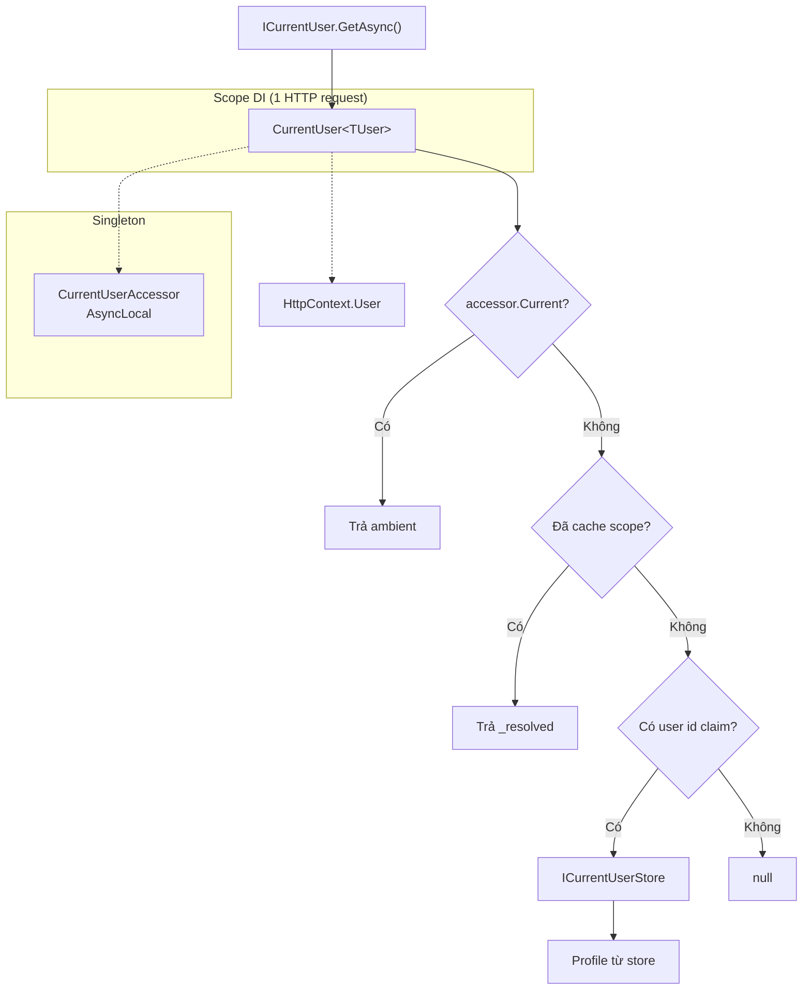
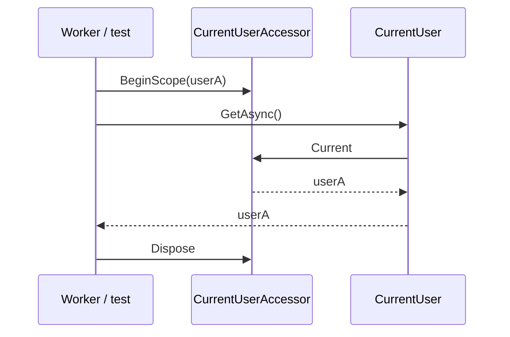

# Current user — `ICurrentUser` và `ICurrentUserAccessor`

Tổng quan Authentication: [README.md](./README.md).

Contract: `Platform.DDD.Domain` (`ICurrentUser<TUser>`, `ICurrentUserAccessor<TUser>`, `ICurrentUserStore<TUser>`).  
Triển khai mặc định: `Platform.Authentication` (`CurrentUser`, `CurrentUserAccessor`).  
Đăng ký DI: `AddCurrentUser<TUser>()` trong [`HostApplicationBuilderExtension.cs`](../../../frameworks/Platform.Authentication/HostApplicationBuilderExtension.cs).

ADR liên quan: [Current user / tenant](../../ADRs/2026-08-01_platform_current-user-tenant.md).

## Đăng ký DI

| Service | Lifetime | Implementation |
|---------|----------|----------------|
| `ICurrentUserAccessor<TUser>` | Singleton | `CurrentUserAccessor<TUser>` — `AsyncLocal` theo luồng async |
| `ICurrentUser<TUser>` | Scoped | `CurrentUser<TUser>` — cache resolve trong một request/scope |

Host **bắt buộc** đăng ký `ICurrentUserStore<TUser>` (DB, cache, in-memory demo).

Sample (`Program.cs`):

```csharp
builder.AddCurrentUser<CurrentUserInfo>();
builder.Services.TryAddSingleton<ICurrentUserStore<CurrentUserInfo>, SampleCurrentUserStore>();
```

Auth scheme (JWT, ApiKey, …) tách qua `AddPlatformAuthentication` — sau `UseAuthentication`, `HttpContext.User` có claim cho bước resolve.

## Thứ tự `GetAsync()`

1. **Ambient** — `ICurrentUserAccessor.Current` (job, test, `BeginScope`)
2. **HTTP** — claim `NameIdentifier` hoặc `sub` trên `HttpContext.User`
3. **Store** — `ICurrentUserStore.FindAsync(userId)`; không có profile → `null` (không fallback)

Trong một scope DI, `CurrentUser` cache `_resolved` / `_loaded` để không gọi store lặp.

## Luồng HTTP (tóm tắt)



## Ambient scope (`BeginScope`)

Dùng khi **không** có `HttpContext` (background worker, message handler, unit test):

```csharp
using (accessor.BeginScope(user))
{
    var profile = await currentUser.GetAsync(); // trả user ambient, không đọc store
}
```

`Dispose` khôi phục giá trị `AsyncLocal` trước đó (scope lồng nhau an toàn).



## Khi nào inject cái gì?

| Inject | Khi |
|--------|-----|
| `ICurrentUser<TUser>` | Application/domain — đọc user hiện tại (khuyến nghị) |
| `ICurrentUserAccessor<TUser>` | Chỉ khi **gán** ambient (`BeginScope`) |

## Tenant (đối xứng)

`ICurrentTenant<TTenant>` / `CurrentTenantAccessor` trong `Platform.Multitenancy` — pattern tương tự; doc tenant: *(bổ sung trong `guides/multitenancy/`)*.

## Source code

- [`CurrentUser.cs`](../../../frameworks/Platform.Authentication/CurrentUser.cs)
- [`CurrentUserAccessor.cs`](../../../frameworks/Platform.Authentication/CurrentUserAccessor.cs)
