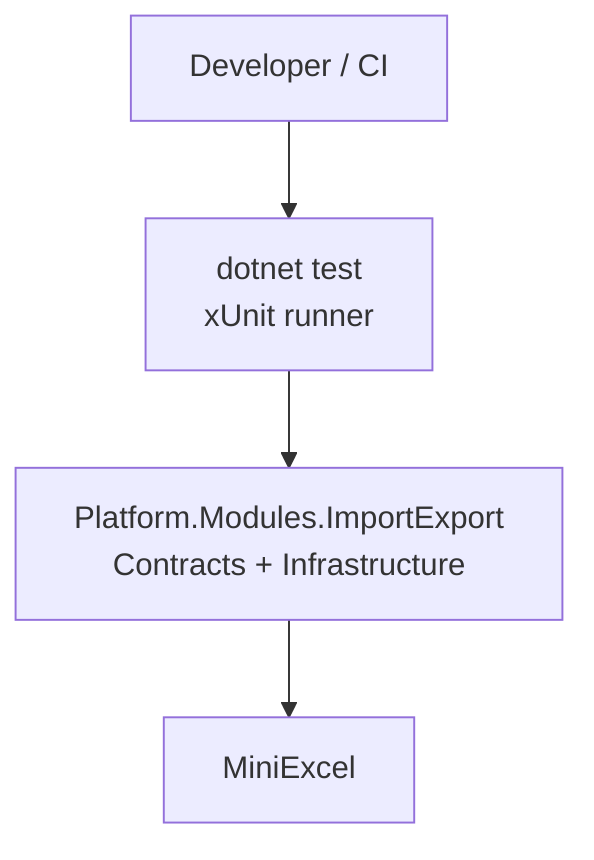
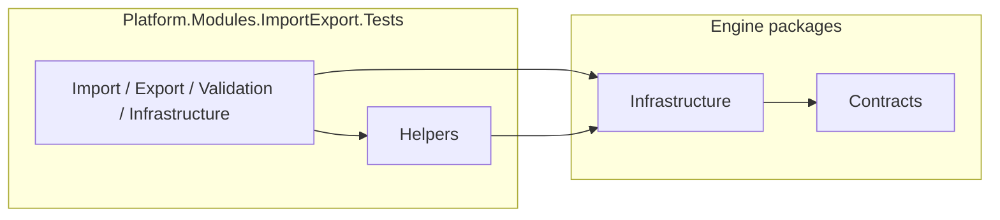
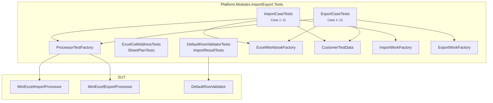

# ADR — Unit Test (Platform.Modules.ImportExport)

**Status:** Accepted (GĐ1)  
**Author:** QUAN  
**Engine version:** 1.1.0  
**Scope:** Project `Platform.Modules.ImportExport.Tests` — chiến lược, cấu trúc folder, codebase chung (Helpers), case Import/Export.  
**Related:** [`SAD-ExcelEngine.md`](SAD-ExcelEngine.md) · [`SAD-Extensibility.md`](SAD-Extensibility.md) · note legacy *Import UnitTest.txt* / *Export UnitTest.txt* (ngoài repo)

> **Không trùng SAD:** SAD mô tả kiến trúc engine; ADR này chỉ mô tả **cách viết & tổ chức unit test**.

---

## 1. Bối cảnh

Platform.Modules.ImportExport là thư viện import/export Excel dùng chung (DLL + API). Cần bộ unit test:

- Bao phủ pipeline **Import** / **Export** theo tiêu đề case trong note cũ (request/response format note có thể lệch — test theo hành vi engine hiện tại).
- Tránh copy-paste tạo workbook / DI processor / sample Customer.
- Dễ mở rộng khi thêm case mới hoặc đổi facade (`ImportWork` / `ExportWork`).

Mục tiêu:

- Tách folder theo domain test (Import, Export, Validation, Infrastructure).
- Có **Helpers** dùng chung (factory processor, workbook in-memory, sample data, work builders).
- Chạy nhanh, không phụ thuộc Postgres / HTTP host / file trên disk repo (trừ khi test integration riêng sau này).

**Mức SUT (quan trọng):** Unit test GĐ1 gọi thẳng **processor** (`MiniExcelImportProcessor` / `MiniExcelExportProcessor`) với `ImportWork` / `ExportWork` — **không** đi qua façade public `IImportService` / `IExportService` (`ImportRequest` + `TemplateCode`). Façade + store được cover gián tiếp bởi ConsumerDemo / API (ngoài ADR này).

---

## 2. Yêu cầu

### 2.1 Functional Requirements (FR)

| Mã | Yêu cầu |
|----|---------|
| FR-01 | Unit test Import processor theo case note (happy path, RowCount, SheetName, HeaderRow, mapping, blank row, StartRow, InvalidRowBehavior Stop/Continue). |
| FR-02 | Unit test Export processor theo case note (success, partial data, header rename, mappings empty/dup, empty data, null field, SheetName). |
| FR-03 | Unit test Validation (row rules, `ImportResult` aggregation / errorSummary). |
| FR-04 | Unit test helper hạ tầng (`ExcelCellAddress`, `SheetPlan` / `ResolveSheetPlans`). |
| FR-05 | Tạo / đọc workbook `.xlsx` **in-memory** (MiniExcel) — không commit file Excel cố định cho case thường. |
| FR-06 | Factory dá»±ng `MiniExcelImportProcessor` / `MiniExcelExportProcessor` vá»›i default ports (no-op persister, default validators). |
| FR-07 | Factory dá»±ng `ImportWork` / `ExportWork` + sample Customer mappings/rows. |
| FR-08 | `dotnet test` xanh toàn bộ project Tests; case đặt tên theo `CaseN_…` khớp tiêu đề note. |

### 2.2 Business Rules (BR)

| Mã | Quy tắc |
|----|---------|
| BR-01 | Test **không** gọi HTTP API / EF Postgres trừ khi sau này có project Integration riêng. |
| BR-02 | Payload test theo contract hiện tại (`ImportWork` / `ExportWork` / `TemplateConfiguration`) — không bám JSON request note cũ nếu đã đổi. |
| BR-03 | Assert theo **hành vi engine thật** (vd. `ColumnNotFound` chỉ fail-fast khi cột Required; export data rỗng = file tạo + 0 data row). |
| BR-04 | Shared code chỉ nằm trong `Helpers/`; test class không copy logic tạo processor / workbook. |
| BR-05 | Namespace theo folder: `Platform.Modules.ImportExport.Tests.{Import\|Export\|Validation\|Infrastructure\|Helpers}`. |
| BR-06 | Timeout soft tắt trong test (`ImportTimeoutSeconds` / `ExportTimeoutSeconds` = 0) để tránh flake. |
| BR-07 | Mỗi case một `[Fact]` / `[Theory]` rõ ràng; tên method bắt đầu `CaseN_` khi map từ note. |
| BR-08 | Default persister = no-op → `SavedCount` thường = 0; assert ưu tiên `ValidRowCount` / `Rows` / exception, không giả định ghi DB. |

---

## 3. Quyết định — tổng quan thành phần

| Thành phần | Vai trò |
|------------|---------|
| `Platform.Modules.ImportExport.Tests` | Project xUnit (.NET 9); reference **Contracts + Infrastructure** (không reference Application/Api). |
| `Helpers/ProcessorTestFactory` | Tạo processor + `ExcelEngineOptions` dùng chung. |
| `Helpers/ExcelWorkbookFactory` | `Create` / `ReadSheet` / `GetSheetNames` (MiniExcel in-memory). |
| `Helpers/CustomerTestData` | Sample Customer rows, mappings EN/VI, `IsBlank`. |
| `Helpers/ImportWorkFactory` | `Template(...)` + `Create(stream, template)`. |
| `Helpers/ExportWorkFactory` | `Create(data, mappings, fileName, sheetName)`. |
| `Import/ImportCaseTests` | Case Import 1–11 theo note. |
| `Export/ExportCaseTests` | Case Export 1–6, 8–9, 11–12 theo note (thiếu Case 7 trong note gốc). |
| `Validation/*` | `DefaultRowValidator`, `ImportResult`. |
| `Infrastructure/*` | `ExcelCellAddress`, `SheetPlan` (cần `InternalsVisibleTo` từ Infrastructure). |
| `GlobalUsings.cs` | `global using Helpers` + `Xunit`. |

**Package / project (Tests.csproj):**

| Loại | Giá trị |
|------|---------|
| Framework | `net9.0` |
| Test | xUnit 2.9.2, Microsoft.NET.Test.Sdk, coverlet |
| Excel | MiniExcel 1.43.1 (trực tiếp — Helpers gen/đọc file) |
| ProjectReference | `Platform.Modules.ImportExport.Contracts`, `Platform.Modules.ImportExport.EntityFramework / Platform.ImportExport.MiniExcel` |
| Internals | `InternalsVisibleTo("Platform.Modules.ImportExport.Tests")` trên Infrastructure |

**Default ports khi `CreateImport()`** (khá»›p production `AddPlatformImportExport` TryAdd):

| Port | Implementation trong test |
|------|---------------------------|
| `IImportRequestValidator` | `ImportRequestValidator` |
| `IRowValidator` | `DefaultRowValidator` |
| `IUniqueValueChecker` | `DefaultUniqueValueChecker` (luôn "không tồn tại") |
| `IImportDataPersister` | `DefaultImportDataPersister` (no-op) |

Cây phụ thuộc test:

```text
ImportCaseTests / ExportCaseTests
        │
        ├── ProcessorTestFactory  → MiniExcel*Processor (SUT)
        ├── ImportWorkFactory / ExportWorkFactory
        ├── CustomerTestData
        └── ExcelWorkbookFactory  → byte[] / MemoryStream .xlsx
```

---

## 4. Kiến trúc (C4 — diagram Mermaid)

> Mermaid flowchart để đọc trên Confluence/Git; không cần tool C4 riêng.

### 4.1 Level 1 — System Context

Ai chạy test, test "nói chuyện" với gì?



- Developer/CI chạy `dotnet test`.
- SUT = library engine (không host API).
- MiniExcel dùng để gen/đọc file trong Helpers.

### 4.2 Level 2 — Container



### 4.3 Level 3 — Component

Các thành phần trong container Tests:



### 4.4 Level 4 — Code

Mức code (factory signature, folder tree, quy ước đặt tên) đặc tả ở **§5** và **§6**.

---

## 5. Mô hình cấu trúc Tests

Không có bảng DB riêng cho unit test. "Model" ở đây là **cấu trúc project + helper API**.

### 5.1 Cây thư mục (canonical)

```text
Platform.Modules.ImportExport.Tests/
├── GlobalUsings.cs
├── Helpers/
│   ├── ProcessorTestFactory.cs
│   ├── ExcelWorkbookFactory.cs
│   ├── CustomerTestData.cs
│   ├── ImportWorkFactory.cs
│   └── ExportWorkFactory.cs
├── Import/
│   └── ImportCaseTests.cs
├── Export/
│   └── ExportCaseTests.cs
├── Validation/
│   ├── DefaultRowValidatorTests.cs
│   └── ImportResultTests.cs
└── Infrastructure/
    ├── ExcelCellAddressTests.cs
    └── SheetPlanTests.cs
```

### 5.2 Helper "contracts" (API dùng chung)

```csharp
// ProcessorTestFactory — dựng SUT
public static MiniExcelImportProcessor CreateImport();
public static MiniExcelExportProcessor CreateExport();
public static ExcelEngineOptions EngineOptions { get; }

// ExcelWorkbookFactory — file ảo
public static MemoryStream Create(IEnumerable<Dictionary<string, object?>> rows, string sheetName = "Customers");
public static IReadOnlyList<IDictionary<string, object?>> ReadSheet(byte[] content, string? sheetName = null);
public static IReadOnlyList<string> GetSheetNames(byte[] content);

// ImportWorkFactory / ExportWorkFactory — work payload
public static TemplateConfiguration Template(...);
public static ImportWork Create(Stream file, TemplateConfiguration template, ...);
public static ExportWork<Dictionary<string, object?>> Create(data, mappings, fileName, sheetName);
```

### 5.3 Sample data

- `CustomerTestData.EnglishMappings()` — header EN khớp file sample.
- `CustomerTestData.VietnameseExportMappings()` — `ColumnName` tiếng Việt (header export).
- `CustomerTestData.SampleCustomersWorkbook()` — 3 dòng CUS001–CUS003.
- `CustomerTestData.IsBlank(value)` — assert cell trống.

**Lý do tách sample:** Import và Export dùng chung domain Customer; đổi fixture một chỗ.

### 5.4 Phân bổ số test (GĐ1)

| Nhóm | Số (khoảng) | Ghi chú |
|------|-------------|---------|
| Import cases | 11 Fact | Case 1–11 |
| Export cases | 10 Fact | Case 1–6, 8–9, 11–12 |
| Validation | 4 Fact | Unique, MaxLength, ImportResult ×2 |
| Infrastructure | Theory + Fact | `ExcelCellAddress` (nhiều InlineData) + `SheetPlan` ×2 |
| **Tổng `dotnet test`** | **38 Passed** | Theory được đếm theo từng InlineData |

---

## 6. Chiến lược chạy test & resolve SUT

### 6.1 Cấu hình tĩnh (options trong test)

```csharp
new ExcelEngineOptions
{
    ImportTimeoutSeconds = 0,
    ExportTimeoutSeconds = 0,
    MaxRowCount = 100_000,
    MaxColumnCount = 200,
    PersistBatchSize = 100,
    IncludeRowsInResponse = true,
    IncludeRowsMaxRowCount = 100_000
}
```

- Timeout = 0 → không soft-cancel trong unit test.
- Persister mặc định: `DefaultImportDataPersister` (no-op) — assert trên `ImportResult.Rows` / counts, không cần DB nghiệp vụ.
- Sheet mặc định khi export `SheetName = null`: `EngineMessages.DefaultExportSheetName` = **`Sheet1`**.

### 6.2 Resolve processor (tương đương "Automatic")

Má»—i test:

1. Tạo file (workbook factory) hoặc data dictionary.
2. Build `ImportWork` / `ExportWork` (**không** resolve `TemplateCode` từ store).
3. Gọi `CreateImport().ImportAsync` / `CreateExport().ExportAsync`.
4. Assert result hoặc exception (`InvalidTemplateException`, `ExcelParsingException`, …).

### 6.3 Quy tắc map từ note cũ

```text
Tiêu đề Case N trong note
    → method CaseN_<Feature>_<Behavior>
    → Expect trong note chỉ là gợi ý
    → Assert = hành vi code hiện tại (BR-03)
```

Ví dụ lệch note đã chốt:

| Case | Note cũ | Hành vi / test hiện tại |
|------|---------|-------------------------|
| Import Case 6 | Column not found luôn | Chỉ khi mapping **Required** thiếu cột |
| Import Case 4 | HeaderRow=5 → NoDataRowsFound | Dùng HeaderRow=2 để ra ColumnNotFound |
| Export Case 8 | Chỉ có Header | File tạo + 0 data row (MiniExcel empty) |
| Export Case 7 | (không có trong note) | Chưa viết test |

### 6.4 Sử dụng

- **Local / CI:** `dotnet test Platform.Modules.ImportExport.Tests`
- **Thêm case mới:** đặt class đúng folder; dùng Helpers; không new processor tay.
- **Đổi contract engine:** sửa Factory trước, rồi sửa assert case.
- **Muốn test façade `IImportService`:** cần mock/register `ITemplateStore` — thuộc integration / phase sau, không nhét vào Helpers hiện tại.

---

## 7. Catalogue case (CRUD tương đương — ma trận case)

### 7.1 Import (`ImportCaseTests`)

| Case | Tiêu đề | Verify chính |
|------|---------|----------------|
| 1 | Happy path | ValidRowCount = 3 |
| 2 | RowCount = 2 | Chỉ 2 dòng |
| 3 | Sai SheetName | `SheetNotFound` |
| 4 | HeaderRow sai | `ColumnNotFound` |
| 5 | Mapping thiếu cột | Chỉ 2 field trong row |
| 6 | Mapping sai tên cột | `ColumnNotFound` (Required) |
| 7 | Row trống chen giữa | Skip blank |
| 8 | Đổi FieldName | Key = Code/Name/… |
| 9 | StartRow = 3 | Bỏ CUS001 |
| 10 | Stop | Dừng sau lỗi đầu |
| 11 | Continue | Skip lỗi, import tiếp |

### 7.2 Export (`ExportCaseTests`)

| Case | Tiêu đề | Verify chính |
|------|---------|----------------|
| 1 | Export thành công | 3 rows + header VI |
| 2 | Nhiều record partial | Field thiếu = blank |
| 3 | Đổi tên header | Key = ColumnName |
| 4 | Mappings empty | `MappingsRequired` |
| 5 | Dup FieldName | `FieldNameUnique` |
| 6 | Dup ColumnName | `ColumnNameUnique` |
| 8 | Data rá»—ng | File + 0 data rows |
| 9 | Null / thiếu field | Blank cells |
| 11 | SheetName | Sheet `Customers` |
| 12 | SheetName null | `Sheet1` default |

### 7.3 Validation / Infrastructure

| Suite | Verify |
|-------|--------|
| `DefaultRowValidatorTests` | Unique in-file, MaxLength |
| `ImportResultTests` | Rows giữ lại + errorSummary theo sheet |
| `ExcelCellAddressTests` | A1 / AA1 mapping |
| `SheetPlanTests` | Legacy + multi-sheet plans |

---

## 8. Cô lập & ranh giới

- **Cô lập I/O:** chỉ MemoryStream; không ghi `template-files` / artifacts.
- **Cô lập DI host:** không `WebApplicationFactory`; wire tay qua Helpers.
- **Cô lập DB:** không `AddPlatformImportExportEntityFramework`; template layout truyền thẳng trong `TemplateConfiguration`.
- **Cô lập façade:** không `ITemplateService` / `TemplateCode` resolve.
- **Ranh giới Integration (ngoài ADR này):** API key, EF migrate, ConsumerDemo, cloud `ITemplateStore`, `SaveAsByTemplate` với file template thật — không nằm trong unit test GĐ1.

```json
{
  "scope": "unit",
  "sut": "MiniExcelImportProcessor | MiniExcelExportProcessor | validators | helpers",
  "out_of_scope": ["Api host", "Postgres", "ITemplateStore cloud", "IImportService façade"]
}
```

---

## 9. Tách trách nhiệm — Helpers vs Case

Khi thêm fixture lớn (nhiều sheet, CSV, template bytes `SaveAsByTemplate`):

1. **Không** nhồi vào `ImportCaseTests`.
2. Thêm method vào `ExcelWorkbookFactory` / `CustomerTestData` (hoặc helper mới `ExportTemplateFactory`).
3. Case chỉ gọi 1–2 dòng setup + assert.

Đây là "separation" tương đương tách metadata vs runtime trong ADR Multi-Tenant mẫu: **shared fixture ≠ assertion logic**.

---

## 10. Kết luận

- Project **`Platform.Modules.ImportExport.Tests`** là chỗ duy nhất cho unit test GĐ1.
- **Helpers** = codebase chung (processor, workbook, Customer, work factories).
- **Import / Export case** map tiêu đề note; assert theo engine hiện tại; SUT = **processor + work**, không phải HTTP/façade.
- **Validation / Infrastructure** bổ sung rule nhỏ không cần file Excel.
- Verify chuẩn: **`dotnet test` xanh** (**38 Passed** tại thời điểm ADR).

---

## 11. Kế hoạch triển khai

> Công việc Unit Test GĐ1 **đã triển khai**; section này ghi lại tái dùng + phase để đồng bộ team / Confluence.

### 11.1 Hiện trạng tái dùng

| Hạng mục ADR | Tài sản đã có | Mức tái dùng | Việc cần làm |
|--------------|---------------|--------------|--------------|
| xUnit project | `Platform.Modules.ImportExport.Tests` | Cao | Giữ; mở rộng case |
| Processor wiring | `ProcessorTestFactory` | Cao | Giữ; thêm options nếu NFR mới |
| Workbook in-memory | `ExcelWorkbookFactory` | Cao | Mở rộng CSV / multi-sheet nếu cần |
| Sample Customer | `CustomerTestData` | Cao | Thêm domain sample khác khi có |
| Import/Export cases | `ImportCaseTests` / `ExportCaseTests` | Cao | Bổ sung Case thiếu từ note (vd. Export Case 7 nếu cần) |
| Validation | `DefaultRowValidatorTests`, `ImportResultTests` | Cao | Thêm regex/min/max nếu cần |
| Default ports rename | `DefaultImportDataPersister`, `DefaultUniqueValueChecker` | Cao | Đã đồng bộ `Default*` (không còn `Null*`) |
| API / EF / façade integration | — | Mới | Project/suite riêng sau (không nhét unit) |
| Template SaveAsByTemplate bytes | Partial (processor hỗ trợ) | Trung bình | Helper tạo template + placeholder test |

**Tổng quan:** Nền Helpers + case Import/Export đã đủ GĐ1. Focus tiếp: case biên (template style export), integration test tách project.

### 11.2 Phase & tiêu chí verify

1. **Phase 0 — Chốt scope:** Unit only, không API/DB → verify: ADR này + SAD §4.
2. **Phase 1 — Helpers:** Factory processor/workbook/data/work → verify: compile, case dùng chung được.
3. **Phase 2 — Import cases 1–11:** → verify: xanh từng Fact.
4. **Phase 3 — Export cases:** → verify: xanh; ghi chú lệch note (Case 8).
5. **Phase 4 — Validation + Infrastructure:** → verify: xanh.
6. **Phase 5 — Folder + GlobalUsings + SAD §4:** → verify: tree đúng ADR §5.1.
7. **Phase 6 — Docs:** ADR này + link từ SAD → verify: `dotnet test` **xanh**.

### 11.3 Điểm cần thống nhất trước khi code thêm

- Đặt tên method: `CaseN_Import|Export_<Behavior>` khi map note.
- Không commit `.xlsx` fixture trừ perf/`testdata` có chủ đích.
- Exception expect: type từ `Contracts.Exceptions` + message/`EngineMessages` khi ổn định.
- Persister thật / unique checker DB: chỉ khi có test integration hoặc test riêng đăng ký override (hiện unit dùng `Default*`).
- Không đổi production code chỉ để "khớp note cũ" — cập nhật expect trong test + ADR §6.3.
- Giữ SUT ở mức processor trừ khi team quyết định thêm suite façade riêng.

---

## Phụ lục — Lệnh verify

```powershell
cd "D:\Source Code\Platform.Modules.ImportExport\Platform.Modules.ImportExport"
dotnet test .\Platform.Modules.ImportExport.Tests\Platform.Modules.ImportExport.Tests.csproj
```

Kỳ vọng: **Passed = 38** (hoặc cao hơn khi thêm case; không được đỏ).
