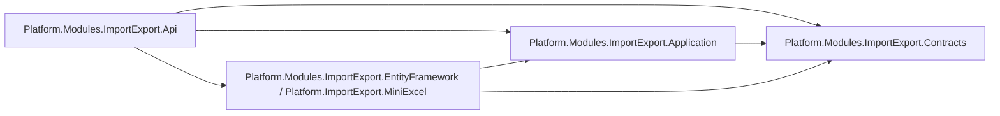
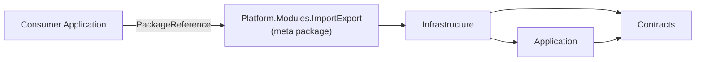
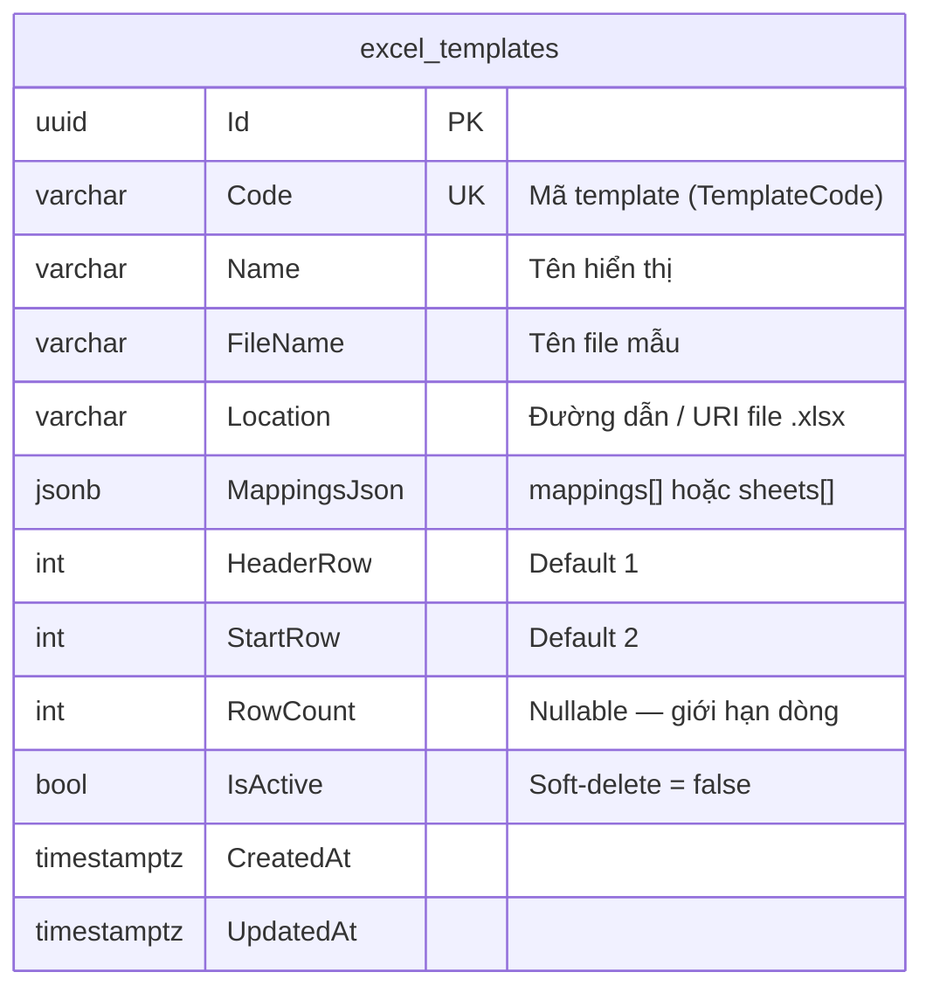
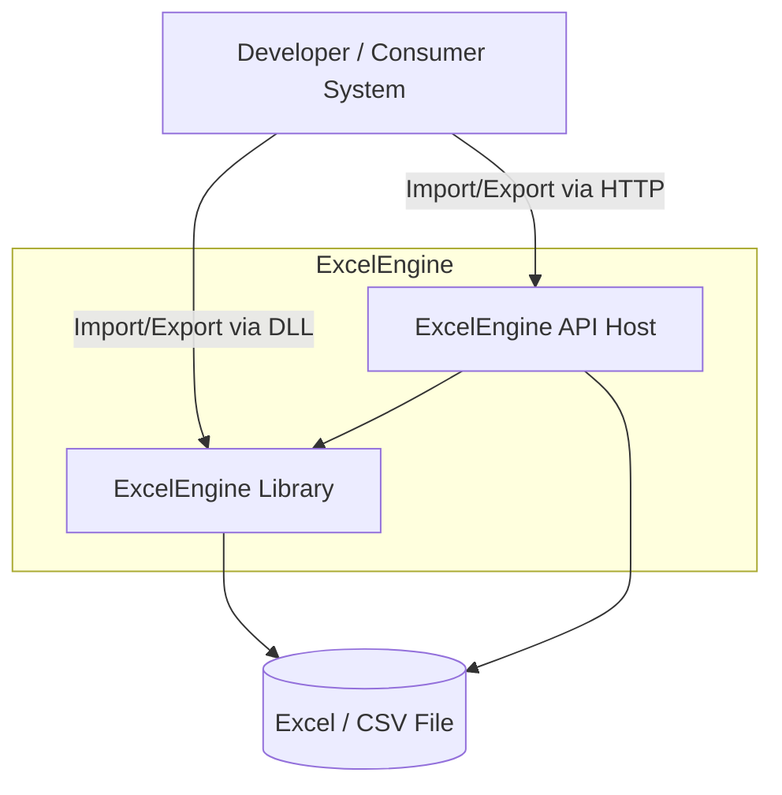
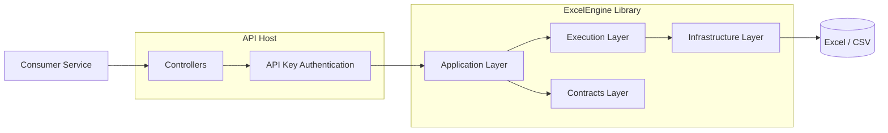
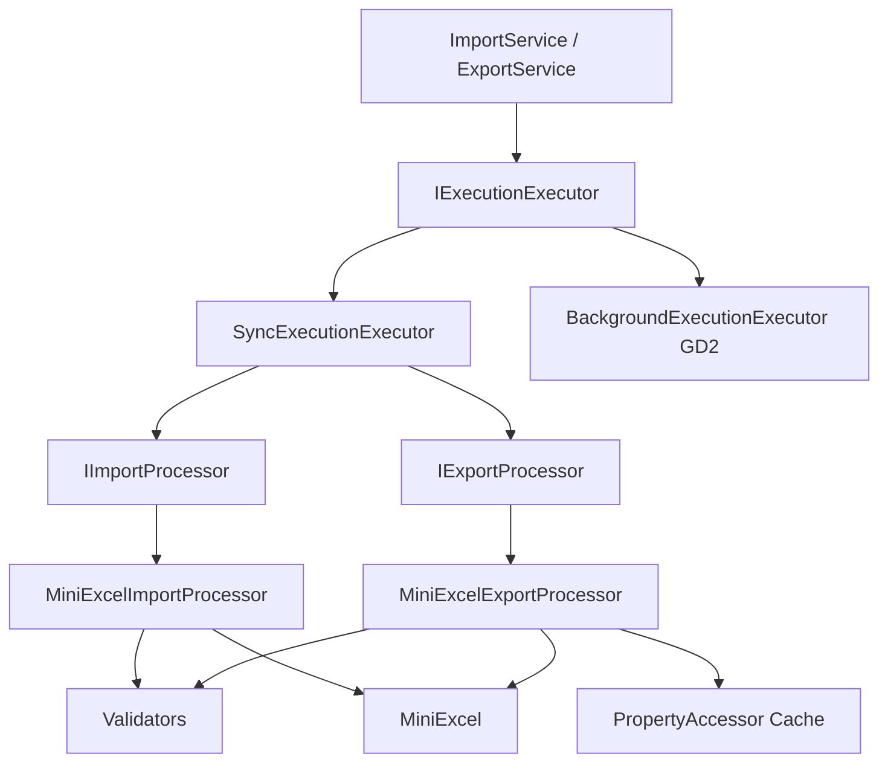
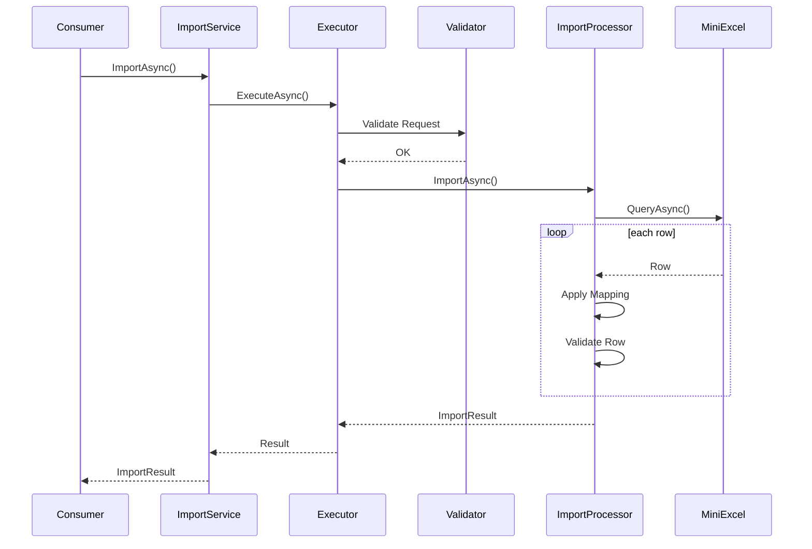
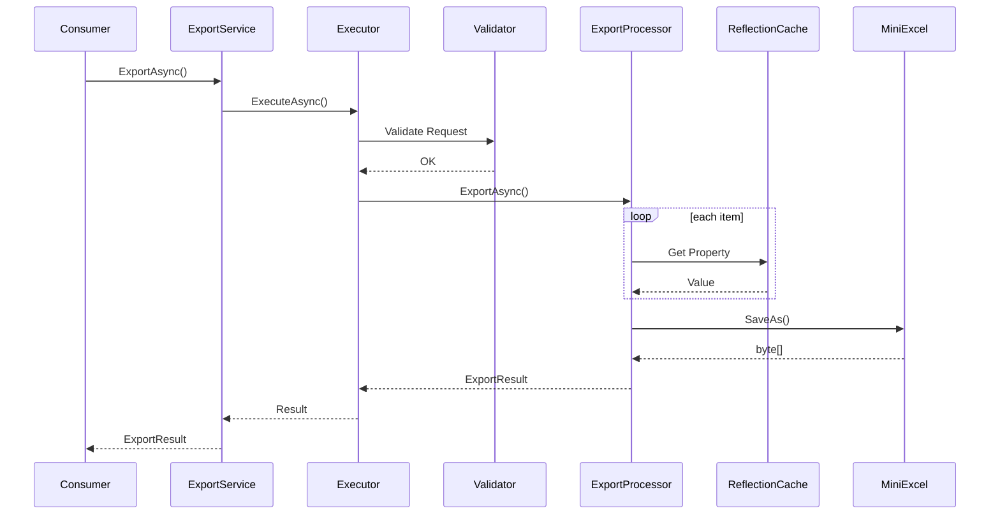
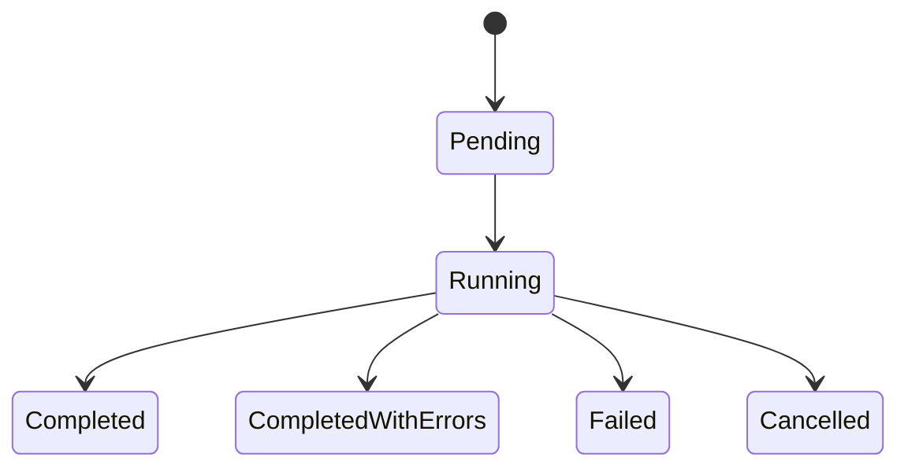
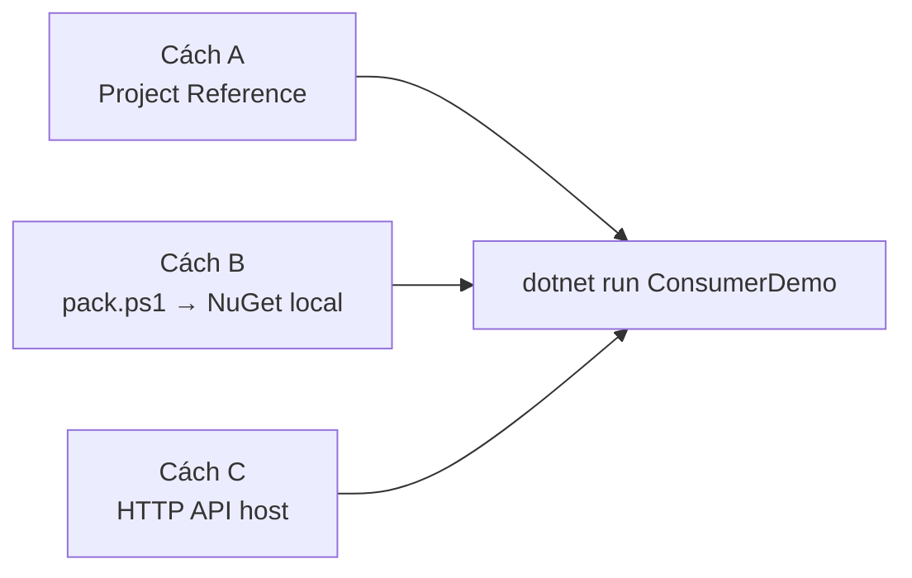

# Software Architecture Document (SAD)

# Platform.Modules.ImportExport

Version: 1.1.0 (NuGet / GĐ1 — cập nhật schema `MappingsJson`, consumer façade `TemplateCode`)

Author: QUAN

Status: Draft

**Mục lục nhanh:** [§2.5 ERD/DB](#25-erd--template-persistence-canonical-gđ1) · [§4 Solution Structure](#4-solution-structure) · [§5 Requests](#5-request--response-contracts) · [§15 Hướng dẫn cài ConsumerDemo](#15-consumer-demo--hướng-dẫn-cài-chi-tiết-dll--nuget--api) · [ADR Unit Test](ADR-UnitTest-ExcelEngine.md)

---

# 1. Overview

## 1.0 Multi-tenant (host-owned)

- Bảng `excel_templates` có `TenantId`; unique `(TenantId, Code)`.
- **Host** (Sample2 / Api demo) resolve tenant (ví dụ header) và set ambient trên UoW/`DbContext` trước khi gọi module.
- Package ImportExport **không** đọc HTTP headers; `DbTemplateStore` chỉ lấy `IStorageContext.TenantId` đã có.
- File path: `{TemplateFilesRoot}/{tenantId}/{code}/{file}`.

## 1.1 Purpose

Platform.Modules.ImportExport là thư viện dùng chung cung cấp khả năng:

- Import dữ liệu từ Excel (.xlsx) hoặc CSV
- Export dữ liệu sang Excel (.xlsx)
- Sử dụng thông qua:
  - NuGet Package / DLL
  - REST API Host
  - Sample consumer: `D:\Source Code\Platform.Modules.ImportExport.ConsumerDemo\` (xem §15)
- Hỗ trợ mapping động giữa cột Excel và object model
- Hỗ trợ validate dữ liệu trước khi xử lý
- Thiết kế mở rộng cho asynchronous processing trong giai đoạn tiếp theo

---

## 1.2 Scope

### GĐ1

Hỗ trợ:

- Import Excel
- Import CSV
- Export Excel
- Sync Processing
- API Key Authentication
- Swagger
- NuGet packaging (`Platform.Modules.ImportExport` meta-package + layer packages)

### GĐ2

Mở rộng:

- Background Job
- Queue Processing
- Import Job Tracking
- Retry
- Monitoring
- Audit Log

---

# 2. Architecture Decision

## 2.1 Technology Stack

| Component | Technology |
|------------|------------|
| Runtime | .NET 9 |
| Excel Engine | MiniExcel |
| API | ASP.NET Core Web API |
| DI | Microsoft Dependency Injection |
| Persistence | PostgreSQL + EF Core |
| Authentication | API Key (`X-Excel-Engine-Key`) |
| Documentation | Swagger |
| Logging | ILogger |
| Serialization | System.Text.Json |
| Distribution | NuGet (`.nupkg` via `pack.ps1` → `artifacts/nuget`) |

---

## 2.2 Architecture Style

Hệ thống áp dụng kiến trúc Layered Architecture.

```text
API
 ↓
Application
 ↓
Contracts
 ↑
Infrastructure
```

Nguyên tắc:

- Contracts không phụ thuộc project nào
- Application chỉ phụ thuộc Contracts
- Infrastructure phụ thuộc Application + Contracts (implement + DI)
- API đóng vai trò Composition Root (không đóng gói NuGet)

---

## 2.3 Project References (Internal Architecture)

The following diagram describes internal project dependencies within the Platform.Modules.ImportExport solution.



### Dependency Rules

#### Contracts

Không reference project nào.

#### Application

Reference:

- Contracts

#### Infrastructure

Reference:

- Application
- Contracts

#### API

Reference:

- Application
- Infrastructure
- Contracts

---

## 2.4 Contracts Structure

```text
Platform.Modules.ImportExport.Contracts

├── Interfaces
│   ├── IImportService / IExportService          // public façade (DLL + API)
│   ├── IImportProcessor / IExportProcessor      // pipeline (ImportWork / ExportWork)
│   ├── ITemplateService / ITemplateStore
│   ├── IImportRequestValidator / IRowValidator
│   ├── IImportDataPersister / IUniqueValueChecker
│   └── IExecutionExecutor
│
├── Requests
│   ├── ImportRequest / ExportRequest<T>         // consumer: TemplateCode + file/data
│   └── ImportWork / ExportWork<T>               // resolved — processor only
│
├── Responses
│   ├── ImportResult / SheetImportResult         // rowsOmitted, ValidRowCount, …
│   ├── ExportResult
│   ├── ImportRowError / ImportErrorSummary
│   └── TemplateSummary / TemplateDetail
│
├── Models
│   ├── ColumnMapping / SheetTemplate / TemplateConfiguration
│   └── ExcelEngineOptions
│
├── Enums
│   ├── ExecutionMode (Sync | Async — GĐ1 chỉ Sync)
│   └── InvalidRowBehavior (Continue | Stop — default Continue)
│
└── Exceptions / Constants / Helpers
```

### Internal Solution Architecture

The solution is internally separated into multiple projects to enforce clear responsibilities and dependency boundaries.


### Internal Responsibilities

| Project | Responsibility | Packable |
|----------|----------|----------|
| Contracts | Public contracts, requests, responses, interfaces, enums, options, exceptions | Yes → `Platform.Modules.ImportExport.Contracts` |
| Application | Business orchestration, validation execution, execution strategy | Yes → `Platform.Modules.ImportExport.Application` |
| Infrastructure | MiniExcel implementation, PostgreSQL template persistence, DI (`AddPlatformImportExport`) | Yes → `Platform.Modules.ImportExport.EntityFramework / Platform.ImportExport.MiniExcel` |
| Platform.Modules.ImportExport (meta) | Meta-package chỉ reference Infrastructure — consumer add 1 package | Yes → `Platform.Modules.ImportExport` |
| Api | HTTP endpoints, authentication, middleware, swagger, composition root | **No** (`IsPackable=false`) |

### Dependency Rules

| Project | Allowed References | Not Allowed |
|----------|----------|----------|
| Contracts | None | Application, Infrastructure, Api |
| Application | Contracts | Infrastructure, Api |
| Infrastructure | Application, Contracts | Api |
| Api | Application, Infrastructure, Contracts | — |
| Meta `Platform.Modules.ImportExport` | Infrastructure | Api |

### Dependency Principle

The solution follows the Dependency Inversion Principle.

```text
Contracts
    ↑
Application
    ↑
Infrastructure
    ↑
Api / NuGet meta-package
```

Rules:

- Contracts must not reference any other project.
- Application depends only on abstractions defined in Contracts.
- Infrastructure implements abstractions and references Application for service wiring.
- API acts as the composition root and is **not** distributed as NuGet.

---

### Consumer Integration

Although the internal solution consists of multiple projects, consumer applications do not reference them directly.

Consumers integrate through:

- **NuGet package `Platform.Modules.ImportExport`** (khuyến nghị), hoặc
- **REST API** `Platform.Modules.ImportExport.Api`

This hides implementation details and simplifies adoption.

### DLL / NuGet Integration



**Consumer chỉ cần:**

```xml
<PackageReference Include="Platform.Modules.ImportExport" Version="1.1.0" />
<PackageReference Include="Platform.Modules.ImportExport.EntityFramework" Version="1.1.0" />
<PackageReference Include="Platform.Modules.ImportExport.API" Version="1.1.0" />
<PackageReference Include="Platform.ImportExport.MiniExcel" Version="1.1.0" />
```

NuGet kéo theo: `Infrastructure` → `Application` + `Contracts` (+ MiniExcel, EF Core, Npgsql, OpenXml, …).

**Không** reference trực tiếp (trừ khi cần tách layer):

```text
Platform.Modules.ImportExport.Contracts
Platform.Modules.ImportExport.Application
Platform.Modules.ImportExport.EntityFramework / Platform.ImportExport.MiniExcel
Platform.Modules.ImportExport.Api
```

Hướng dẫn từng bước (ProjectReference / NuGet / API) + ảnh: **§15. Consumer Demo**.

#### Pack & publish (repo)

| Item | Chi tiết |
|------|----------|
| Script | `.\pack.ps1` (trong `Platform.Modules.ImportExport\`) |
| Output | `artifacts/nuget/*.nupkg` |
| Packages | `Platform.Modules.ImportExport`, `.Contracts`, `.Application`, `.Infrastructure` |

```bash
dotnet add package Platform.Modules.ImportExport --version 1.1.0 --source "<path-to>/artifacts/nuget"
```

---

### API Integration

Consumers may also integrate through HTTP APIs.


The API host internally uses the same Application and Infrastructure components as the NuGet package, ensuring consistent behavior across both integration methods.

---

## 2.5. ERD — Template Persistence (canonical GĐ1)

Template metadata lưu **PostgreSQL một bảng** `excel_templates`.  
Mapping / multi-sheet layout nằm trong cột **`MappingsJson` (jsonb)** — không còn bảng `excel_template_mappings`, không còn cột `Kind` / `Content` (bytea) / `SheetName`.

File Excel mẫu lưu trên disk (hoặc blob) qua **`Location`**; engine đọc bytes khi export / download.



### excel_templates

| Type | Field | Description |
|------|--------|-------------|
| uuid | Id | Primary key |
| varchar(100) | Code | Unique — dùng làm `TemplateCode` khi import/export |
| varchar(200) | Name | Tên hiển thị |
| varchar(260) | FileName | Tên file template |
| varchar(1000) | Location | Path/URI tới file trên `TemplateFilesRoot` (nullable nếu chưa ghi file) |
| jsonb | MappingsJson | Layout: array mapping, hoặc `{ "sheetName", "mappings" }`, hoặc `{ "sheets":[...] }` |
| int | HeaderRow | Dòng header (default `1`) |
| int | StartRow | Dòng bắt đầu data (default `2`) |
| int | RowCount | Giới hạn số dòng (nullable) |
| bool | IsActive | Soft-delete: `false` = ẩn (EF query filter) |
| timestamptz | CreatedAt | Thời điểm tạo |
| timestamptz | UpdatedAt | Cập nhật gần nhất |

**Constraints:** Unique index trên `Code`.

**Migrations:** `*_TemplateMappingsJson.cs`, `*_DropTemplateSheetNameColumn.cs`. Apply: `Database.MigrateAsync()` khi API start.

### MappingsJson — hình dạng

```json
// 1) Legacy: mọi sheet cùng mapping (không sheetName)
[ { "columnName": "CustomerCode", "fieldName": "CustomerCode", "required": true } ]

// 2) Một sheet chỉ định
{ "sheetName": "Customers", "mappings": [ ... ] }

// 3) Multi-sheet — mỗi sheet mapping riêng
{
  "sheets": [
    { "sheetName": "Customers", "mappings": [ ... ], "startRow": 2 },
    { "sheetName": "Orders", "mappings": [ ... ], "startRow": 2 }
  ]
}
```

| Cấu hình | Hành vi Import |
|----------|----------------|
| `mappings: [...]` không `sheetName` | Import **mọi sheet** trong file, cùng mapping |
| `mappings` + `sheetName: "X"` | Chỉ sheet X |
| `sheets: [{ sheetName, mappings }, ...]` | Mỗi sheet mapping riêng |

### Sample (Leader Review)

| Code | FileName | Location | MappingsJson (tóm tắt) |
|------|----------|----------|-------------------------|
| `CUS_IMPORT_V1` | `MasterData.xlsx` | `template-files/.../CUS_IMPORT_V1.xlsx` | `sheets[Customers]` + mappings CustomerCode/Name/… |
| `ORD_IMPORT_V1` | `MasterData.xlsx` | `…/ORD_IMPORT_V1.xlsx` | `sheets[Orders]` + mappings OrderCode/Amount/… |

Hoặc **một** template multi-sheet nếu muốn 1 lần import cả `Customers` + `Orders`.

### Runtime Flow (API)

| API | Input | Persist |
|-----|--------|---------|
| `POST /api/v1/templates` | File + `Mappings` JSON | Insert `excel_templates` + ghi file → `Location` |
| `PUT /api/v1/templates/{code}` | Partial | Update metadata / `MappingsJson` / file |
| `DELETE /api/v1/templates/{code}` | Soft-delete | `IsActive = false` |
| `POST /api/v1/excel/import` | `File` + `TemplateCode` | Load layout từ store → stream MiniExcel → result |
| `POST /api/v1/excel/export` | `TemplateCode` + `data` | Resolve template → `SaveAsByTemplate` (giữ style) |

> Folder store (`AddLlaExcelFolderTemplates`): không dùng Postgres — meta `{code}.json` + file xlsx dưới `TemplateFilesRoot`.

---

# 3. C4 Model

# 3.1 Level 1: System Context



## Context Description

Platform.Modules.ImportExport là thành phần dùng chung cung cấp khả năng:

- Import dữ liệu từ Excel/CSV
- Export dữ liệu ra Excel
- Mapping động giữa cột Excel và model nghiệp vụ

ExcelEngine không sở hữu dữ liệu nghiệp vụ.

Toàn bộ:

- cấu hình mapping
- file nguồn
- dữ liệu export

được cung cấp bởi consumer.

ExcelEngine chỉ đóng vai trò:

```text
File Processing Engine
```

không phải:

```text
Business System
```

---

## Supported Integration Modes

### DLL Mode (NuGet)

```xml
<PackageReference Include="Platform.Modules.ImportExport" Version="1.1.0" />
<PackageReference Include="Platform.Modules.ImportExport.EntityFramework" Version="1.1.0" />
<PackageReference Include="Platform.Modules.ImportExport.API" Version="1.1.0" />
<PackageReference Include="Platform.ImportExport.MiniExcel" Version="1.1.0" />
```

```csharp
services.AddPlatformImportExport();
// Template store (bắt buộc chọn một):
// services.AddPlatformImportExportEntityFramework(configuration);   // Postgres + Location
// services.AddLlaExcelFolderTemplates();          // folder JSON + xlsx
// services.AddScoped<ITemplateStore, MyAzureOrS3Store>();

// Inject:
//   IImportService
//   IExportService
//   ITemplateService (sau khi đã đăng ký ITemplateStore)
```

Import trả `IReadOnlyDictionary<string, object?>` theo `FieldName` — consumer tự map sang DTO domain.

---

### API Mode

Consumer gọi (API Key header `X-Excel-Engine-Key`):

```http
POST /api/v1/excel/import
POST /api/v1/excel/export
POST /api/v1/templates
```

API host sử dụng chính library bên dưới (`AddPlatformImportExport` + `AddPlatformImportExportEntityFramework`).

Không tồn tại business logic Excel riêng ở API.

---

# 3.2. C4 — Level 2: Container Diagram



## Container Responsibilities

### API Host

Chức năng:

- Authentication
- Authorization
- Swagger
- HTTP Adapter

Không chứa:

- Import logic
- Export logic

---

### Contracts

Chứa:

- Requests
- Responses
- Models
- Interfaces
- Enums
- Exceptions

---

### Application

Chứa:

- ImportService
- ExportService
- ExecutionExecutor

Điều phối nghiệp vụ.

Không chứa logic MiniExcel.

---

### Infrastructure

Chứa:

- MiniExcelImportProcessor
- MiniExcelExportProcessor
- Validators
- Reflection Cache
- Helpers

---

# 3.3. C4 — Level 3: Component Diagram

## Component Overview



---

## Import Flow



---

## Export Flow



---

# 4. Solution Structure

```text
D:\Source Code\
├── Platform.Modules.ImportExport\                          # Engine repo
│   └── Platform.Modules.ImportExport\
│       ├── Platform.Modules.ImportExport.sln
│       ├── Platform.Modules.ImportExport\                  # Meta NuGet package
│       ├── Platform.Modules.ImportExport.Contracts\        # Ports + DTOs
│       ├── Platform.Modules.ImportExport.Application\      # ImportService / ExportService
│       │   ├── Services\
│       │   └── Execution\
│       ├── Platform.Modules.ImportExport.EntityFramework / Platform.ImportExport.MiniExcel\
│       │   ├── Processors\                   # MiniExcel import/export
│       │   ├── Helpers\                      # ExcelCellAddress, Injector, BatchBuffer, …
│       │   ├── Validation\
│       │   ├── Stores\                       # Db / Folder / Default adapters
│       │   ├── Persistence\                  # EF + excel_templates
│       │   ├── Services\                     # TemplateService
│       │   └── DependencyInjection\
│       ├── Platform.Modules.ImportExport.Api\              # HTTP host (không pack)
│       ├── Platform.Modules.ImportExport.Tests\
│       │   ├── Helpers\                      # ProcessorTestFactory, workbook, sample data
│       │   ├── Import\ / Export\             # Case tests
│       │   ├── Validation\
│       │   └── Infrastructure\
│       ├── doc\                              # SAD, ADR
│       │   ├── SAD.md
│       │   ├── SAD-Extensibility.md
│       │   └── ADR-*.md
│       └── testdata\                         # File perf / generator
│
└── Platform.Modules.ImportExport.ConsumerDemo\             # Project demo RIÊNG (ngoài engine)
    ├── Platform.Modules.ImportExport.ConsumerDemo.sln
    ├── README.md
    └── Platform.Modules.ImportExport.ConsumerDemo\         # Console: DLL + HTTP API
```

---

# 5. Request / Response Contracts

## ImportRequest

Public DLL/API — engine resolve template theo code:

```csharp
ImportRequest
{
    string TemplateCode;       // required
    Stream FileStream;         // required
    string FileName;           // required (DLL: để biết .xlsx/.csv; API lấy từ IFormFile)
    ExecutionMode ExecutionMode; // default Sync — không bắt truyền
}
```

HTTP mirror: `ImportApiRequest` (`File` + `TemplateCode`).

Sau resolve → `ImportWork` (có `TemplateConfiguration`) → `IImportProcessor`.

## ExportRequest

```csharp
ExportRequest<T>
{
    string TemplateCode;       // required
    IEnumerable<T> Data;       // required
    string? FileName;          // optional — mặc định template.FileName
    ExecutionMode ExecutionMode; // default Sync
}
```

HTTP mirror: `ExportApiRequest` (`TemplateCode` + `Data` + `FileName?`).

Sau resolve → `ExportWork<T>` → `SaveAsByTemplate` / `SaveAs`.

## ImportResult

```csharp
ImportResult
{
    IReadOnlyList<SheetImportResult> Sheets;
    IReadOnlyList<ImportRowError> Errors;     // flat (DLL); HTTP dùng sheets[].errorSummary
    int ProcessedRowCount;
    int FailedRowCount;
    int SavedCount;
    int ValidRowCount;
}

SheetImportResult
{
    string SheetName;
    IReadOnlyList<...> Rows;     // có thể rỗng khi rowsOmitted
    IReadOnlyList<ImportErrorSummary> ErrorSummary;
    int ProcessedRowCount;
    int FailedRowCount;
    int ValidRowCount;           // độc lập với Rows.Count
    bool RowsOmitted;            // true = không trả payload rows (RAM / IncludeRowsMaxRowCount)
}
```

## ExportResult

```csharp
ExportResult
{
    byte[] Content;
    string FileName;
}
```

---

# 6. Validation Rules

## File Validation

- File không được null
- File không được rỗng
- Chỉ hỗ trợ:
  - .xlsx
  - .csv

---

## Template Validation

- StartRow >= 1
- HeaderRow >= 1
- Mapping không được rỗng

---

## Mapping Validation

- ColumnName bắt buộc
- FieldName bắt buộc
- ColumnName không được trùng
- FieldName không được trùng

---

# 7. Technical Limits

| Rule | Default |
|--------|----------|
| Max File Size | 50 MB |
| Max Rows | 1,000,000 |
| Max Mapping Count | 500 |
| Max Cell Length | 4000 |

---

# 8. Transaction Strategy

## GĐ1

Import Engine hiện tại:

```text
Read
 ↓
Validate
 ↓
Map
 ↓
Return Result
```

Không ghi database.

Không sử dụng transaction.

---

## GĐ2

Khi hỗ trợ lưu database:

```text
Read
 ↓
Validate
 ↓
Batch Processing
 ↓
Persist
```

---

## Transaction Modes

```csharp
public enum TransactionMode
{
    None,
    Batch,
    AllOrNothing
}
```

### None

Row lỗi bỏ qua.

### Batch

Rollback batch hiện tại.

### AllOrNothing

Rollback toàn bộ.

---

# 9. Template Configuration

## GĐ1 (hiện tại) — pluggable store

- **Port:** `ITemplateStore` — consumer chọn DB / Folder / Blob.
- **Default adapters:** `DbTemplateStore` (Postgres + `Location` file), `FolderTemplateStore`.
- **API façade:** `ITemplateService` → gọi `ITemplateStore` (CRUD HTTP).
- Soft-delete (Db): `IsActive = false`; `Code` vẫn reserved sau soft-delete.
- Mapping: cột **`MappingsJson`** trên `excel_templates` (không còn bảng `excel_template_mappings`).
- Không còn cột `Kind` / `Content` bytea / **`SheetName`** — tên sheet nằm trong `MappingsJson` (`sheetName` hoặc `sheets[].sheetName`).

```csharp
public interface ITemplateStore
{
    Task<TemplateDefinition?> GetByCodeAsync(string code, CancellationToken cancellationToken = default);
    Task SaveAsync(TemplateDefinition template, CancellationToken cancellationToken = default);
    Task DeleteAsync(string code, CancellationToken cancellationToken = default);
    Task<IReadOnlyList<TemplateDefinition>> ListAsync(CancellationToken cancellationToken = default);
}
```

Chi tiết consumer customize + **sample copy-paste** (`MyOrderPersister`, `MyBlobTemplateStore`, validators, DI):  
→ [`SAD-Extensibility.md`](SAD-Extensibility.md) · demo chạy được: `Sample/ImportExport/`

### Leader checklist → ports (đã có)

| Mục | Port | Default |
|-----|------|---------|
| Customize template / load | `ITemplateStore` | **Bắt buộc** — `AddPlatformImportExportEntityFramework` / Folder / custom Azure·S3 |
| Save DB (implement) | `IImportDataPersister` | `DefaultImportDataPersister` (no-op); production đăng ký trước `AddPlatformImportExport` |
| Validate request (factory override) | `IImportRequestValidator` | `ImportRequestValidator` |
| Validate row | `IRowValidator` | `DefaultRowValidator` |
| Unique vs DB nghiệp vụ | `IUniqueValueChecker` | `DefaultUniqueValueChecker` (luôn "không tồn tại") |
| Processor | `IImportProcessor` | `MiniExcelImportProcessor` |

Đăng ký custom storage **trước** `AddPlatformImportExport` (`TryAdd*` không ghi đè).


**Export template (MiniExcel):** luôn `SaveAsByTemplate` khi có file template — giữ style + sheet name.
Nếu template chưa có `{{rows.FieldName}}`, engine tự inject vào `StartRow` (khớp header) rồi đổ data.

### Performance (NFR-001 / RISK-001) — GĐ1

| Setting | Default | Ý nghĩa |
|---------|---------|---------|
| `ImportTimeoutSeconds` | 300 | Soft cancel import (408 nếu hết giờ) |
| `ExportTimeoutSeconds` | 300 | Soft cancel export |
| `PersistBatchSize` | 2000 | Persist + clear batch (giảm RAM) |
| `IncludeRowsInResponse` | true | Có trả `rows` trong response không |
| `IncludeRowsMaxRowCount` | 10000 | Vượt ngưỡng → `rowsOmitted`, chỉ counts + errorSummary |
| Kestrel / RequestTimeouts | 6 phút | Host timeout ≥ engine timeout |

Import: MiniExcel `QueryAsync` stream → validate → batch `IImportDataPersister` → xả batch.  
File rất lớn / 500k+: tăng timeout hoặc dùng async job (GĐ2).

Domain runtime: `TemplateConfiguration` + `ColumnMapping` (từ store khi import/export).

---

## GĐ2

Versioning template, audit, multi-tenant.

---

### Tables (canonical)

Chỉ **`excel_templates`** (`MappingsJson` jsonb, `Location`, soft-delete `IsActive`).  
Không còn `excel_template_mappings` / cột `SheetName` / `Content` bytea. Chi tiết ERD: **§2.5**.

---

# 10. Background Processing (GĐ2)

## ImportJob

Một record tương ứng một lần import.

| Column | Description |
|----------|-------------|
| JobId | Id |
| FileName | File |
| Status | Current status |
| StartedAt | Start time |
| FinishedAt | End time |
| TotalRows | Total rows |
| SuccessRows | Success rows |
| FailedRows | Failed rows |
| ErrorFile | Error report |

---

## ImportJobDetail

Chỉ lưu row lỗi.

| Column | Description |
|----------|-------------|
| JobId | FK |
| RowNumber | Excel row |
| ErrorCode | Error code |
| ErrorMessage | Message |
| OriginalData | Original row |

---

## Job Lifecycle



---

## Retention Policy

| Entity | Retention |
|----------|----------|
| ImportJob | 90 days |
| ImportJobDetail | 30 days |

Cleanup Job chạy hàng ngày.

---

# 11. Error Handling

## Exception Hierarchy

```text
ExcelEngineException
│
├── InvalidTemplateException
├── UnsupportedFileException
├── FileTooLargeException
├── RowLimitExceededException
├── ExcelParsingException
├── ExportException
├── TemplateNotFoundException
└── TemplateAlreadyExistsException
```

---

## Import row/field errors (DLL + API)

Import validation returns structured errors. With `InvalidRowBehavior.Continue` (default), valid rows are kept; bad rows appear in summaries.

- **DLL `ImportResult.Errors`** — flat, one entry per failing cell `(row, column, sheet)` (highlight / library consumers).
- **API + DLL `sheets[].errorSummary`** — grouped per sheet by `(errorCode, columnName, fieldName, message)` with `rowNumbers[]`. No top-level `errorSummary`; `sheetName` is on the parent sheet object. HTTP payload does **not** expose flat `errors`.
- **`failedRowCount`** — sum of distinct failing Excel rows across sheets (used in the 422 message).
- **Import** load template via **`GetForExecutionAsync`** (metadata + mappings — không cần file bytes).
- **Export** load template via **`GetAsync`** — `Content` được đọc từ file theo `Location` (không còn cột bytea trên DB) để MiniExcel `SaveAsByTemplate` / fallback `SaveAs`.

```csharp
public sealed record ImportRowError(
    int RowNumber,
    string Message,
    string? ColumnName = null,
    string? FieldName = null,
    string? ErrorCode = null,   // FieldRequired, InvalidFormat, ...
    string? SheetName = null);

public sealed record ImportErrorSummary(
    string Message,
    IReadOnlyList<int> RowNumbers,
    string? ColumnName = null,
    string? FieldName = null,
    string? ErrorCode = null);  // Count => RowNumbers.Count; sheetName on SheetImportResult
```

Example API payload (Phone required empty on rows 6, 8, 10 of Customers):

```json
{
  "data": {
    "sheets": [
      {
        "sheetName": "Customers",
        "rows": [],
        "errorSummary": [
          {
            "message": "Column 'Phone' (field 'Phone') is required.",
            "rowNumbers": [6, 8, 10],
            "columnName": "Phone",
            "fieldName": "Phone",
            "errorCode": "FieldRequired",
            "count": 3
          }
        ],
        "processedRowCount": 6,
        "failedRowCount": 3
      }
    ],
    "processedRowCount": 6,
    "failedRowCount": 3
  },
  "status": 422,
  "message": "Import failed: 3 row(s) have validation errors."
}
```

---

## API Error Response

Envelope: `data` / `status` / `message` (`ApiResponse<T>`).

---

# 12. Security

## Authentication

API Key Authentication.

Header:

```http
X-Excel-Engine-Key
```

---

## File Protection

Validate:

- Extension
- MIME Type
- File Size
- Row Count

---

## Resource Protection

Ngăn chặn:

- Memory Exhaustion
- Oversized Upload
- Excessive Row Count

---

# 13. Observability

## Logs (shared DLL via `ILogger<T>`)

Infrastructure processors/services log through `Microsoft.Extensions.Logging` so API host and DLL consumers share the same events:

| Event | Level | Fields |
|-------|--------|--------|
| API import/export/template received | Information | TemplateCode, FileName, Phase, EntityKey / Operation |
| Import/Export request (façade) | Information | TemplateCode, counts, DurationMs |
| Import/Export started | Information | FileName, SheetName, MappingCount, StartRow |
| Import sheet start/finish | Information | Sheet, ProcessedRows, ValidRows, ErrorCount, SavedCount |
| Row validation failed | Warning | Sheet, Row, Column, Field, Code, Message |
| Persist batch completed | Information | TemplateCode, EntityKey, BatchSize, SavedCount, ErrorCount |
| Soft timeout | Warning | Operation, TimeoutSeconds |
| Import/Export finished | Information | ProcessedRows, ValidRows, ErrorCount / Bytes + DurationMs |
| Template create/update/delete | Information | Code, MappingCount, FileName |
| Unexpected failure | Error | Exception |
| Scope | — | Operation, TemplateCode, FileName, Phase |

## API host — file log

Serilog writes rolling files under `logs/excel-engine-YYYYMMDD.log` (retain 30 days) + console.

DLL consumers: register their own `ILogger` / Serilog sink; **no** file path is hard-coded inside the engine.

---

Export Failed

---

## Metrics (GĐ2)

- Import Duration
- Export Duration
- Processed Rows
- Failed Rows

---

# 14. Future Roadmap

## GĐ2

- Background Job
- Queue Processing
- ImportJob
- Retry
- Monitoring
- Audit

## GĐ3

- Multi File Import
- Scheduled Import
- Cloud Storage Integration

---

# 15. Consumer Demo — hướng dẫn cài chi tiết (DLL / NuGet / API)

Project demo **nằm ngoài** repo engine:

```text
D:\Source Code\Platform.Modules.ImportExport.ConsumerDemo\
├── nuget.config                          # source LlaExcelLocal + nuget.org
├── Platform.Modules.ImportExport.ConsumerDemo.sln
├── README.md
└── Platform.Modules.ImportExport.ConsumerDemo\
    ├── Platform.Modules.ImportExport.ConsumerDemo.csproj
    ├── Program.cs
    └── appsettings.json
```

Mục đích: thử **cùng API surface** khi gọi DLL hoặc HTTP.



| Cách | Khi nào dùng | Cần pack? |
|------|----------------|-----------|
| **A. Project Reference** | Dev cùng máy, sửa engine liên tục | Không |
| **B. NuGet local** | Giống project thật / demo đóng gói | Có (`pack.ps1`) |
| **C. HTTP API** | Không reference DLL | Không (chạy Api host) |

> **Lưu ý quan trọng:** Package `Platform.Modules.ImportExport` **không có trên nuget.org**.  
> Nếu Package source = `nuget.org` → "No packages found" + hàng loạt lỗi thiếu `Contracts` / `AddPlatformImportExport`.  
> Phải dùng **Project Reference** hoặc feed **local** sau khi pack.

---

## 15.1 Mở & chạy ConsumerDemo

1. Mở `D:\Source Code\Platform.Modules.ImportExport.ConsumerDemo\Platform.Modules.ImportExport.ConsumerDemo.sln` (Visual Studio / Rider / VS Code).
2. Restore + chạy:

```powershell
cd "D:\Source Code\Platform.Modules.ImportExport.ConsumerDemo"
dotnet restore
dotnet run --project .\Platform.Modules.ImportExport.ConsumerDemo\Platform.Modules.ImportExport.ConsumerDemo.csproj
```

Menu console:

| Phím | Việc |
|------|------|
| 1 | DLL — tạo template sample `CUSTOMER_DEMO` |
| 2 | DLL — Import sample Excel |
| 3 | DLL — Export ra `bin/.../output/` |
| 4 | API — Import HTTP |
| 5 | API — Export HTTP |
| 0 | Exit |

---

## 15.2 Cách A — Project Reference (khuyên dùng khi đang code engine)

Không cần NuGet. Reference thẳng meta project `Platform.Modules.ImportExport`.

### Từng bước (Visual Studio)

1. Mở `Platform.Modules.ImportExport.ConsumerDemo.sln`
2. Solution Explorer → chuột phải project **`Platform.Modules.ImportExport.ConsumerDemo`**
3. **Add** → **Project Reference…**
4. **Browse** tá»›i:

   `D:\Source Code\Platform.Modules.ImportExport\Platform.Modules.ImportExport\Platform.Modules.ImportExport\Platform.Modules.ImportExport.csproj`

5. Tick **`Platform.Modules.ImportExport`** → **OK**
6. Build (Ctrl+Shift+B) — hết lỗi thiếu namespace

> UI tương đương: **Add → Project Reference → Browse** → chọn `.csproj` meta package ở trên.

### Trong `.csproj`

```xml
<!-- Cách A: bỏ PackageReference Platform.Modules.ImportExport nếu đang dùng -->
<ItemGroup>
  <ProjectReference Include="..\..\Platform.Modules.ImportExport\Platform.Modules.ImportExport\Platform.Modules.ImportExport\Platform.Modules.ImportExport.csproj" />
</ItemGroup>
```

### Đăng ký DI (bắt buộc)

```csharp
services.Configure<ExcelEngineOptions>(
    configuration.GetSection("ExcelEngine"));

services.AddPlatformImportExport();
services.AddLlaExcelFolderTemplates(); // demo: folder store, không cần Postgres
// Production DB:
// services.AddPlatformImportExportEntityFramework(configuration);
```

### Gọi import / export

```csharp
await importService.ImportAsync(new ImportRequest
{
    TemplateCode = "CUSTOMER_DEMO",
    FileStream = stream,
    FileName = "data.xlsx"   // DLL bắt buộc (để biết .xlsx/.csv)
});

await exportService.ExportAsync(new ExportRequest<MyRow>
{
    TemplateCode = "CUSTOMER_DEMO",
    Data = rows
    // FileName optional → mặc định tên file template
});
```

---

## 15.3 Cách B — NuGet local (giống production)

### Bước 1 — Pack package từ repo engine

```powershell
cd "D:\Source Code\Platform.Modules.ImportExport\Platform.Modules.ImportExport"
.\pack.ps1
```

Kết quả (ví dụ):

```text
D:\Source Code\Platform.Modules.ImportExport\Platform.Modules.ImportExport\artifacts\nuget\
  Platform.Modules.ImportExport.1.1.0.nupkg
  Platform.Modules.ImportExport.Contracts.1.1.0.nupkg
  Platform.Modules.ImportExport.Application.1.1.0.nupkg
  Platform.Modules.ImportExport.EntityFramework / Platform.ImportExport.MiniExcel.1.1.0.nupkg
```

Consumer chỉ cần cài meta package **`Platform.Modules.ImportExport`** (kéo theo các package còn lại).

### Bước 2 — Khai báo NuGet source local

**Cách khuyến nghị:** file `nuget.config` cạnh solution ConsumerDemo (đã có sẵn):

```xml
<?xml version="1.0" encoding="utf-8"?>
<configuration>
  <packageSources>
    <clear />
    <!-- Relative từ folder Platform.Modules.ImportExport.ConsumerDemo -->
    <add key="LlaExcelLocal"
         value="..\Platform.Modules.ImportExport\Platform.Modules.ImportExport\artifacts\nuget" />
    <add key="nuget.org"
         value="https://api.nuget.org/v3/index.json"
         protocolVersion="3" />
  </packageSources>
</configuration>
```

Hoặc CLI (machine-wide):

```powershell
dotnet nuget add source "D:\Source Code\Platform.Modules.ImportExport\Platform.Modules.ImportExport\artifacts\nuget" --name LlaExcelLocal
```

### Bước 3 — Cài package vào ConsumerDemo

**Visual Studio**

1. Chuột phải project → **Manage NuGet Packages…**
2. Tab **Browse**
3. **Package source** (góc phải) đổi từ `nuget.org` → **`LlaExcelLocal`** (hoặc `All`)
4. Search: `Platform.Modules.ImportExport`
5. Chọn version **1.1.0** → **Install**

> Nếu vẫn để source = `nuget.org` → **No packages found** (đúng, vì chưa publish public).

**CLI**

```powershell
cd "D:\Source Code\Platform.Modules.ImportExport.ConsumerDemo\Platform.Modules.ImportExport.ConsumerDemo"
dotnet add package Platform.Modules.ImportExport --version 1.1.0 --source LlaExcelLocal
```

### Bước 4 — `.csproj` sau khi cài

**Xóa** `ProjectReference` (nếu có). Chỉ giữ:

```xml
<ItemGroup>
  <PackageReference Include="Platform.Modules.ImportExport" Version="1.1.0" />
  <PackageReference Include="Platform.Modules.ImportExport.EntityFramework" Version="1.1.0" />
  <PackageReference Include="Platform.Modules.ImportExport.API" Version="1.1.0" />
  <PackageReference Include="Platform.ImportExport.MiniExcel" Version="1.1.0" />
</ItemGroup>
```

### Bước 5 — Restore / Build

```powershell
cd "D:\Source Code\Platform.Modules.ImportExport.ConsumerDemo"
dotnet restore
dotnet build
```

Hết lỗi `CS0234` / `AddPlatformImportExport` là OK. DI + gọi API như §15.2.

### Bước 6 — Mỗi lần sửa code engine

Phải **pack lại** rồi ConsumerDemo restore lại version mới (hoặc tăng Version trong `Directory.Build.props`).  
Muốn thấy thay đổi ngay không pack → quay về **Cách A**.

---

## 15.4 Troubleshooting (lỗi hay gặp)

| Hiện tượng | Nguyên nhân | Cách xử lý |
|------------|-------------|------------|
| NuGet: **No packages found** | Source = `nuget.org` | Đổi sang `LlaExcelLocal` / pack trước |
| `CS0234` namespace Contracts / Infrastructure | Chưa reference package/project | Cách A hoặc B |
| `AddPlatformImportExport` not found | Thiếu using / chưa restore | `using Platform.Modules.ImportExport.EntityFramework / Platform.ImportExport.MiniExcel.DependencyInjection;` + restore |
| `NU1301` local source doesn't exist | Sai path trong `nuget.config` | Path phải trỏ tới `...\Platform.Modules.ImportExport\Platform.Modules.ImportExport\artifacts\nuget` |
| Template not found khi menu 2/3 | Chưa tạo template | Chạy menu **1** trước |
| API 401 | Sai API key | Khá»›p `Security:ApiKey` (Api) vá»›i `ConsumerDemo:ApiKey` (demo) |

---


## 15.5 Cách C — Chỉ gọi HTTP API (không cài DLL)

Không cần ProjectReference / PackageReference `Platform.Modules.ImportExport`.

1. Chạy host: `Platform.Modules.ImportExport.Api` → mặc định `http://localhost:5251`
2. `dotnet user-secrets set "Security:ApiKey" "local-dev-key" --project Platform.Modules.ImportExport.Api`
3. Trong demo `appsettings.json`: `"ApiBaseUrl": "http://localhost:5251"`, `"ApiKey": "local-dev-key"`
4. Tạo template trên API (DB) với cùng `TemplateCode`
5. Menu demo **4** / **5**

Header: `X-Excel-Engine-Key`.

| Endpoint | Body |
|----------|------|
| `POST /api/v1/excel/import` | multipart: `File` + `TemplateCode` |
| `POST /api/v1/excel/export` | JSON: `templateCode` + `data` + `fileName?` |

---

## 15.6 Tham số consumer (tóm tắt)

| | Import | Export |
|--|--------|--------|
| Bắt buộc | `TemplateCode` + file | `TemplateCode` + `Data` |
| Optional | — | `FileName` |
| Không cần truyền | `ExecutionMode` (default Sync), Mappings / HeaderRow / TemplateContent | cùng |

Chi tiết extensibility: [`SAD-Extensibility.md`](SAD-Extensibility.md) · demo: `Sample/ImportExport/`

---

# 16. Consequences

## Advantages

- Reusable
- Lightweight
- Easy Integration (1 NuGet package `Platform.Modules.ImportExport`)
- API + DLL Support
- Consumer demo tách repo — dễ onboarding

## Disadvantages

- Sync Processing giới hạn file lớn ở GĐ1
- Chưa hỗ trợ queue processing
- Package nội bộ: phải pack local / feed riêng (không có trên nuget.org)

---


