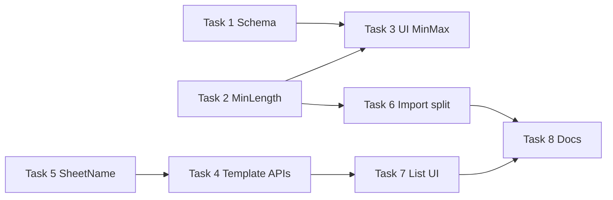

# ImportExport Post-Demo Enhancements — Implementation Plan

> **For agentic workers:** REQUIRED SUB-SKILL: Use `superpowers:subagent-driven-development` (recommended) or `superpowers:executing-plans` to implement this plan task-by-task. Steps use checkbox (`- [ ]`) syntax for tracking.

**Goal:** Bổ sung module ImportExport sau demo: schema reflection đầy đủ, `minLength` trong mapping, tách API/UI sửa template, validate `sheetName` theo loại file, tách luồng import validate/import, và tách cột Rows trên danh sách template.

**Architecture:** Mở rộng contract hiện có (backward-compatible JSON): thêm field optional `minLength`, mở rộng `ImportExportFieldSchema`, tách endpoint template thành metadata vs configuration, thêm `ImportMode` (`ValidateOnly` | `Import`) trên façade import, UI điều kiện theo `dataType`/`fileType`. Không đổi ERD — vẫn một bảng `excel_templates`.

**Tech Stack:** .NET 9, Platform.Modules.ImportExport (Core / MiniExcel / Api / EF), React (`@platform/importexport`), xUnit.

## Global Constraints

- **Backward compatible:** Parser chấp nhận mapping cũ không có `minLength`; API cũ `PUT /templates/{code}` có thể giữ làm alias hoặc deprecate có ghi chú migration.
- **Code immutable:** `TemplateCode` không đổi sau create — UI disable, BE reject nếu client gửi thay đổi code.
- **SheetName rule:** File `.csv` → `sheetName` optional; file `.xlsx` → `sheetName` bắt buộc (template create/update + validate request).
- **Min/Max UI:** Chỉ hiện cột Min/Max khi `dataType` ∈ `{ int, long, decimal, double, float, number }`.
- **Import split:** `POST .../import/validate` không gọi `IImportDataPersister`; `POST .../import` giữ hành vi persist hiện tại.
- **Tests:** Mỗi task BE có unit test tương ứng trong `Platform.Modules.ImportExport.Tests`.

---

## File map

| Action | Path | Responsibility |
|--------|------|----------------|
| Modify | `Application/Schemas/ReflectionFieldReader.cs` | `[MinLength]`, granular `dataType`, `isNumeric` |
| Modify | `Application/Schemas/Models/ImportExportEntitySchema.cs` | Thêm `MinLength`, `ClrType`, `IsNumeric` |
| Modify | `Domain/Models/ColumnMapping.cs` | Thêm `MinLength` |
| Modify | `Domain/Constants/MappingJsonConstants.cs` | JSON key `minLength` |
| Modify | `Application/Common/Validation/ColumnMappingJsonParser.cs` | Parse/serialize `minLength` |
| Modify | `Application/Common/Validation/MappingValidator.cs` | Validate `minLength` ≤ `maxLength` |
| Modify | `frameworks/.../Validation/DefaultRowValidator.cs` | Enforce `minLength` on string fields |
| Modify | `frameworks/.../Validation/ImportRequestValidator.cs` | SheetName rule theo extension |
| Create | `Application/Templates/ITemplateMetadataService.cs` (hoặc mở rộng `ITemplateService`) | Update metadata vs configuration |
| Modify | `Api/Controllers/TemplatesController.cs` | `PATCH metadata` + `PUT configuration` |
| Modify | `Application/Import/IImportService.cs` | `ValidateAsync` hoặc `ImportMode` |
| Modify | `Application/Import/ImportService.cs` | Wire validate-only |
| Modify | `frameworks/.../Processors/MiniExcelImportProcessor.cs` | Skip persist khi validate-only |
| Modify | `Api/Controllers/ExcelController.cs` | `POST import/validate` |
| Modify | `frontend/.../types/index.ts` | Types mới |
| Modify | `frontend/.../components/MappingTable.tsx` | MinLength + conditional Min/Max |
| Modify | `frontend/.../pages/TemplateListPage.tsx` | 3 cột row |
| Split | `frontend/.../pages/TemplateFormPage.tsx` | Metadata vs Configuration forms |
| Modify | `frontend/.../services/index.ts` | API clients mới |
| Modify | `frontend/.../validation/index.ts` | Zod sheetName theo file type |
| Modify | `docs/sad/sad.md` | Spec v1.3.0 (đã cập nhật) |
| Create | `Tests/Schemas/ReflectionFieldReaderTests.cs` | Schema tests |
| Create | `Tests/Validation/SheetNameValidationTests.cs` | CSV vs Excel |
| Create | `Tests/Import/ValidateOnlyImportTests.cs` | Validate-only flow |

---

## Task 1: Schema reflection — đầy đủ attribute + dataType

**Files:**
- Modify: `Application/Schemas/Models/ImportExportEntitySchema.cs`
- Modify: `Application/Schemas/ReflectionFieldReader.cs`
- Modify: `frontend/src/features/importexport/types/index.ts`
- Create: `Platform.Modules.ImportExport.Tests/Schemas/ReflectionFieldReaderTests.cs`

**Interfaces — produces:**

```csharp
public sealed record ImportExportFieldSchema(
    string Name,
    string DisplayName,
    string DataType,       // string | boolean | datetime | guid | int | long | decimal | double | float | enum
    string ClrType,        // e.g. "System.Int32"
    bool Required,
    int? MinLength,
    int? MaxLength,
    decimal? Min,
    decimal? Max,
    string? Regex,
    bool IsNumeric);
```

- [x] **Step 1:** Mở rộng record + `MapProperty` đọc `[MinLength]`, map granular numeric types, set `IsNumeric`.
- [x] **Step 2:** Unit test: DTO có `[Required]`, `[MinLength(2)]`, `[MaxLength(50)]`, `[Range(0,100)]`, `[RegularExpression]` → response đủ field.
- [x] **Step 3:** Cập nhật TS `ImportExportFieldSchema` khớp BE.
- [x] **Step 4:** `dotnet test Platform.Modules.ImportExport.Tests --filter ReflectionFieldReader`

---

## Task 2: MinLength trong ColumnMapping / MappingJson

**Files:**
- Modify: `Domain/Models/ColumnMapping.cs`
- Modify: `Domain/Constants/MappingJsonConstants.cs`
- Modify: `Application/Common/Validation/ColumnMappingJsonParser.cs`
- Modify: `Application/Common/Validation/MappingValidator.cs`
- Modify: `frameworks/Platform.ImportExport.MiniExcel/Validation/DefaultRowValidator.cs`
- Modify: `frontend/.../components/MappingTable.tsx`
- Modify: `frontend/.../pages/TemplateFormPage.tsx` (auto-fill từ schema)

**JSON shape (camelCase):**

```json
{
  "columnName": "Code",
  "fieldName": "Code",
  "required": true,
  "minLength": 2,
  "maxLength": 20,
  "min": null,
  "max": null,
  "regex": null
}
```

- [ ] **Step 1:** Thêm `MinLength` vào `ColumnMapping` + parser constants.
- [ ] **Step 2:** `MappingValidator`: nếu cả `minLength` và `maxLength` có giá trị → `minLength <= maxLength`.
- [ ] **Step 3:** `DefaultRowValidator`: string field — lỗi `MinLength` khi `value.Length < mapping.MinLength`.
- [ ] **Step 4:** UI `MappingTable`: cột **MinLen**; auto-fill từ schema khi chọn entity field.
- [ ] **Step 5:** Unit tests parser + row validator.

---

## Task 3: UI MappingTable — Min/Max chỉ cho kiểu số

**Files:**
- Modify: `frontend/.../components/MappingTable.tsx`
- Modify: `frontend/.../pages/TemplateFormPage.tsx`

**Behavior:**
- Lưu map `fieldName → ImportExportFieldSchema` khi user chọn entity.
- Cột Min / Max: `disabled` + ẩn input khi `!schema.isNumeric`.
- Cột MinLen / MaxLen: hiện khi `dataType === 'string'` hoặc `enum`.

- [ ] **Step 1:** Pass `fieldSchemas: Record<string, ImportExportFieldSchema>` vào `MappingTable`.
- [ ] **Step 2:** Conditional render/disable theo `isNumeric` / `dataType`.
- [ ] **Step 3:** Manual test trên Sample web.

---

## Task 4: Tách API sửa template (metadata vs configuration)

**Files:**
- Modify: `Api/Controllers/TemplatesController.cs`
- Modify: `Application/Templates/ITemplateService.cs` + `TemplateService.cs`
- Modify: `Api/Models/` (form DTOs)
- Modify: `frontend/.../services/index.ts`
- Split: `frontend/.../pages/TemplateFormPage.tsx` → `TemplateMetadataPage.tsx` + `TemplateConfigurationPage.tsx`
- Modify: `frontend/.../routes/index.ts`

**Endpoints mới:**

| Method | Route | Body | Mục đích |
|--------|-------|------|----------|
| `PATCH` | `/api/v1/templates/{code}` | JSON: `{ "name": "..." }` | Đổi tên hiển thị |
| `PUT` | `/api/v1/templates/{code}/configuration` | multipart: File?, Mappings, HeaderRow, StartRow, RowCount | File + layout |
| `PUT` | `/api/v1/templates/{code}` | *(deprecated)* | Alias configuration — giữ 1 release |

**UI routes:**
- `/import-export/templates/:code/edit` → form metadata (Code disabled, Name editable)
- `/import-export/templates/:code/configuration` → form file + rows + mapping

List actions: icon **Sửa tên** vs **Cấu hình** (hoặc dropdown).

- [ ] **Step 1:** BE `UpdateMetadataAsync(code, name)` + `UpdateConfigurationAsync(...)`.
- [ ] **Step 2:** Controller + validation.
- [ ] **Step 3:** FE routes + 2 pages; code field `readOnly`.
- [ ] **Step 4:** Integration test `TemplateServiceTests` cho từng endpoint.

---

## Task 5: Validate sheetName theo loại file (CSV vs Excel)

**Files:**
- Modify: `frameworks/.../Validation/ImportRequestValidator.cs`
- Create: `Application/Templates/TemplateFileTypeHelper.cs` (`.csv` / `.xlsx`)
- Modify: `Application/Templates/TemplateService.cs` (create/update)
- Modify: `frontend/.../validation/index.ts`
- Modify: `frontend/.../pages/TemplateConfigurationPage.tsx`
- Create: `Tests/Validation/SheetNameValidationTests.cs`

**Rules:**

| File extension | `sheetName` trong MappingsJson |
|----------------|--------------------------------|
| `.csv` | Optional — bỏ qua nếu trống |
| `.xlsx` | **Required** — 400 nếu thiếu (single-sheet layout) |

Multi-sheet (`sheets[]`): mỗi entry vẫn cần `sheetName` (Excel).

UI: field Sheet name — `required` khi file là `.xlsx`; ẩn hoặc optional khi `.csv`.

- [ ] **Step 1:** Helper `ResolveFileType(fileName)`.
- [ ] **Step 2:** Validator BE trên create/update template + import request.
- [ ] **Step 3:** Zod `.superRefine` trên FE theo `file.name`.
- [ ] **Step 4:** Unit tests CSV ok without sheetName; Excel fails without sheetName.

---

## Task 6: Tách luồng import — Validate vs Import

**Files:**
- Modify: `Application/Import/Models/ImportRequest.cs` — thêm `ImportExecutionPhase` enum
- Modify: `Application/Import/IImportService.cs`
- Modify: `Application/Import/ImportService.cs`
- Modify: `frameworks/.../Processors/MiniExcelImportProcessor.cs`
- Modify: `Api/Controllers/ExcelController.cs`
- Modify: `Api/Models/ImportApiResponse.cs` (nếu cần flag `validatedOnly`)
- Modify: `Sample/clients/web` — `StudentImportPage` gọi validate trước, import sau
- Create: `Tests/Import/ValidateOnlyImportTests.cs`

**Endpoints:**

| Method | Route | Hành vi |
|--------|-------|---------|
| `POST` | `/api/v1/excel/import/validate` | Read → map → validate rows; **không** `IImportDataPersister.SaveAsync` |
| `POST` | `/api/v1/excel/import` | Full pipeline (validate + persist) |

**DLL:**

```csharp
public enum ImportExecutionPhase { ValidateOnly, Import }

public sealed class ImportRequest
{
    // existing...
    public ImportExecutionPhase Phase { get; init; } = ImportExecutionPhase.Import;
}
```

**Response:** Cùng `ImportApiResponse` / `ImportResult`. Validate-only: `savedCount = 0` luôn.

**UI flow (Sample StudentImport):**
1. User chọn file → **Validate** → hiển thị `ImportResultPanel` + errors.
2. Nếu `failedRowCount == 0` → enable **Import** → gọi `/import`.

- [ ] **Step 1:** Enum + propagate `Phase` qua `ImportWork`.
- [ ] **Step 2:** Processor skip persist batch khi `ValidateOnly`.
- [ ] **Step 3:** API endpoint `import/validate`.
- [ ] **Step 4:** FE two-step + tests.

---

## Task 7: Template list — tách cột Rows

**Files:**
- Modify: `frontend/.../pages/TemplateListPage.tsx`

**Thay cột `Rows` (H1 / S2 / N100) bằng:**

| Header row | Start row | Row count |
|------------|-----------|-----------|
| `1` | `2` | `100` hoặc `—` |

- [ ] **Step 1:** 3 `<DataTable.THeadCell>` + cells tương ứng.
- [ ] **Step 2:** Cập nhật `colSpan` empty state (5 → 7).

---

## Task 8: Docs & version bump

**Files:**
- Modify: `docs/sad/sad.md` — v1.3.0
- Modify: `Platform.Modules.ImportExport/doc/SAD-Extensibility.md` (nếu có contract mới)

- [ ] **Step 1:** Verify SAD §17 khớp implementation.
- [ ] **Step 2:** Bump package version `1.2.0` → `1.3.0` khi release.

---

## Thứ tự triển khai đề xuất



**Status:** Implemented (2026-08-12). Tests: **80 passed**.

---

## Test plan (manual)

1. Entity fields API trả `minLength`, `clrType`, `isNumeric`; field `int` có `min`/`max`, field `string` không bắt buộc min/max trên UI.
2. Tạo template CSV không sheetName → OK; Excel không sheetName → 400.
3. PATCH name only; PUT configuration đổi file/mapping không đổi code.
4. Import validate trả errors, `savedCount=0`; import sau validate thành công persist (khi host có persister).
5. List template hiển thị 3 cột row riêng biệt.
