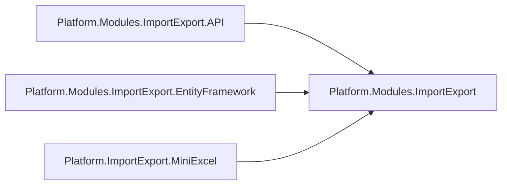
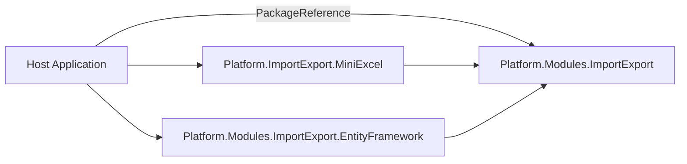
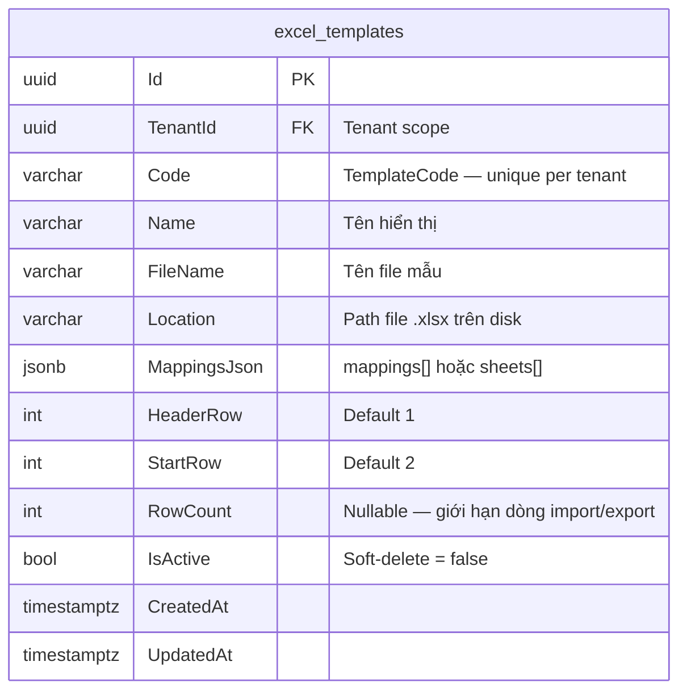
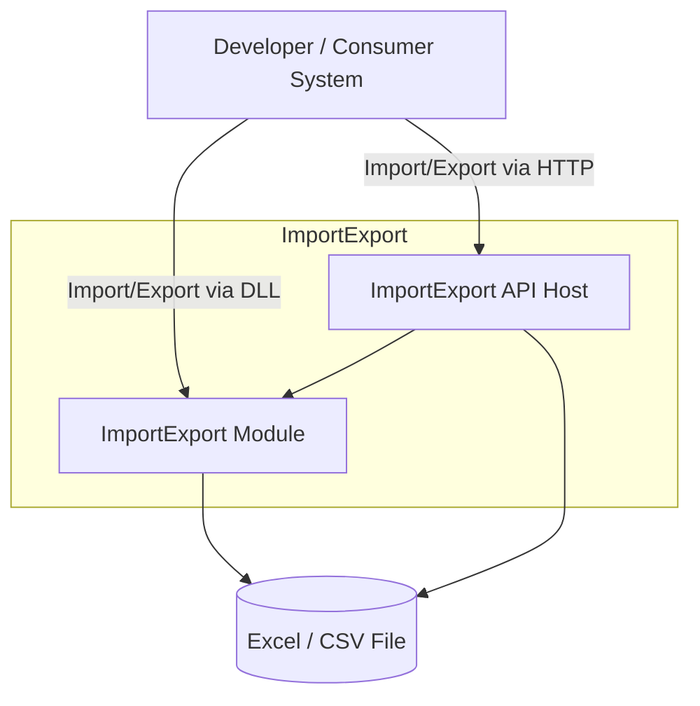
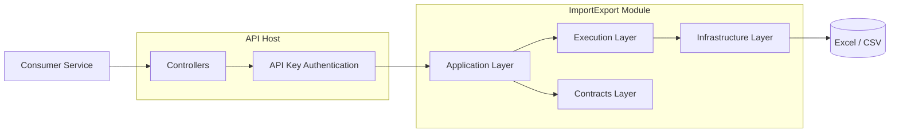
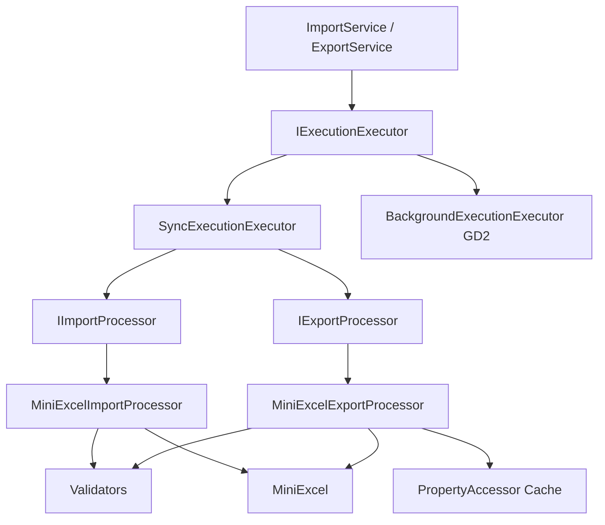
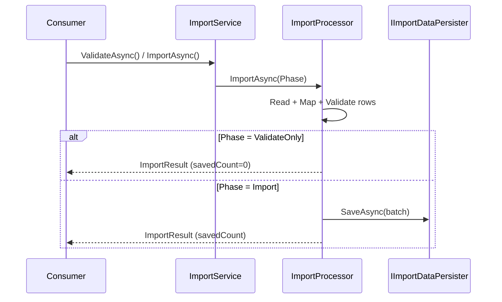
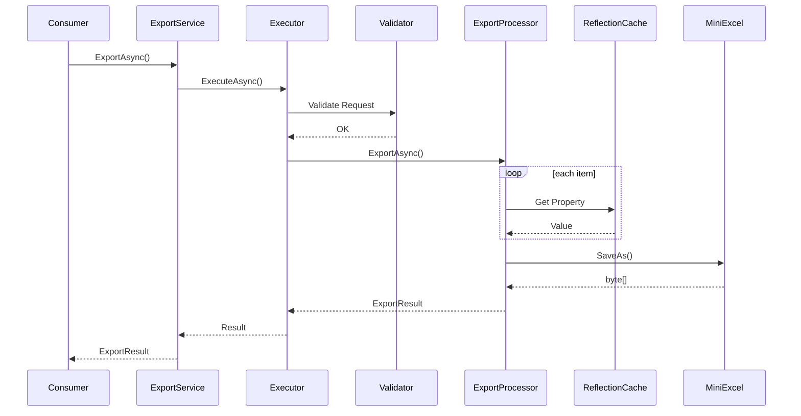
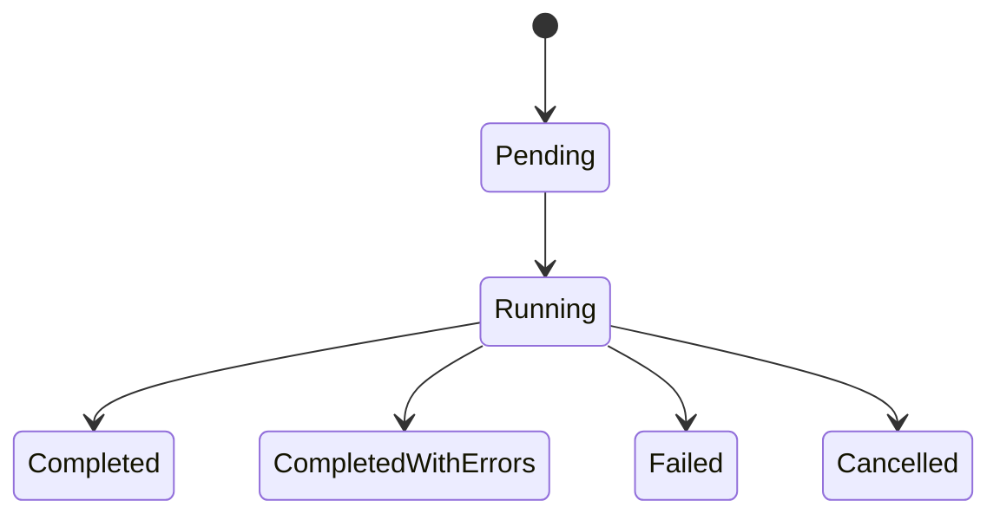
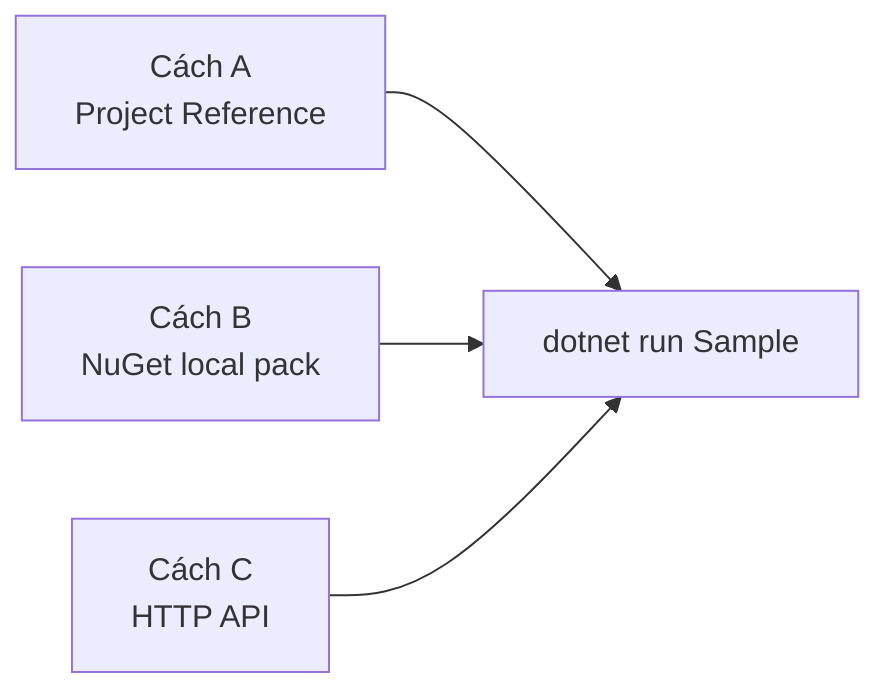

# Software Architecture Document (SAD)

# Platform.Modules.ImportExport

Version: 1.3.0 (Post-demo — schema đầy đủ, minLength, tách template/import API, sheetName theo file type)

Author: TungPT

Status: Draft

## Mục lục

### Tài liệu liên quan
- [Plan triển khai v1.3.0](../plans/2026-08-12-importexport-post-demo-enhancements.md)
- [ADR](../ADR/README.md)

### Nội dung

- [1. Overview](#1-overview)
  - [1.0 Multi-tenant (host-owned)](#10-multi-tenant-host-owned)
  - [1.1 Purpose](#11-purpose)
  - [1.2 Scope](#12-scope)
    - [GĐ1](#gđ1)
    - [GĐ2](#gđ2)
- [2. Architecture Decision](#2-architecture-decision)
  - [2.1 Technology Stack](#21-technology-stack)
  - [2.2 Architecture Style](#22-architecture-style)
  - [2.3 Project References (Internal Architecture)](#23-project-references-internal-architecture)
    - [Packages](#packages)
    - [Dependency Rules](#dependency-rules)
    - [Consumer DI (fluent)](#consumer-di-fluent)
  - [2.4 Core Structure](#24-core-structure)
    - [Public ports (tóm tắt)](#public-ports-tóm-tắt)
    - [Consumer Integration](#consumer-integration)
    - [DLL / NuGet Integration](#dll--nuget-integration)
      - [Pack & publish (repo)](#pack--publish-repo)
    - [API Integration](#api-integration)
  - [2.5. ERD — Template Persistence (canonical GĐ1)](#25-erd--template-persistence-canonical-gđ1)
    - [excel_templates](#excel_templates)
    - [MappingsJson — hình dạng](#mappingsjson--hình-dạng)
    - [Sample (Leader Review)](#sample-leader-review)
    - [Runtime Flow (API)](#runtime-flow-api)
  - [2.6 Entity Registry — Schema Discovery](#26-entity-registry--schema-discovery)
- [3. C4 Model](#3-c4-model)
- [3.1 Level 1: System Context](#31-level-1-system-context)
  - [Context Description](#context-description)
  - [Supported Integration Modes](#supported-integration-modes)
    - [DLL Mode (NuGet)](#dll-mode-nuget)
    - [API Mode](#api-mode)
- [3.2. C4 — Level 2: Container Diagram](#32-c4--level-2-container-diagram)
  - [Container Responsibilities](#container-responsibilities)
    - [API Host](#api-host)
    - [Contracts](#contracts)
    - [Application](#application)
    - [Infrastructure](#infrastructure)
- [3.3. C4 — Level 3: Component Diagram](#33-c4--level-3-component-diagram)
  - [Component Overview](#component-overview)
  - [Import Flow (v1.3.0 — validate / import tách bước)](#import-flow-v130--validate--import-tách-bước)
  - [Export Flow](#export-flow)
- [4. Solution Structure](#4-solution-structure)
- [5. Request / Response Contracts](#5-request--response-contracts)
  - [ImportRequest](#importrequest)
  - [ExportRequest](#exportrequest)
  - [ImportResult](#importresult)
  - [ExportResult](#exportresult)
- [6. Validation Rules](#6-validation-rules)
  - [File Validation](#file-validation)
  - [Template Validation](#template-validation)
  - [Mapping Validation](#mapping-validation)
- [7. Technical Limits](#7-technical-limits)
- [8. Transaction Strategy](#8-transaction-strategy)
  - [GĐ1](#gđ1-1)
  - [GĐ2](#gđ2-1)
  - [Transaction Modes](#transaction-modes)
    - [None](#none)
    - [Batch](#batch)
    - [AllOrNothing](#allornothing)
- [9. Template Configuration](#9-template-configuration)
  - [GĐ1 (hiện tại) — pluggable store](#gđ1-hiện-tại--pluggable-store)
    - [Leader checklist → ports (đã có)](#leader-checklist--ports-đã-có)
    - [Performance (NFR-001 / RISK-001) — GĐ1](#performance-nfr-001--risk-001--gđ1)
  - [GĐ2](#gđ2-2)
    - [Tables (canonical)](#tables-canonical)
- [10. Background Processing (GĐ2)](#10-background-processing-gđ2)
  - [ImportJob](#importjob)
  - [ImportJobDetail](#importjobdetail)
  - [Job Lifecycle](#job-lifecycle)
  - [Retention Policy](#retention-policy)
- [11. Error Handling](#11-error-handling)
  - [Exception Hierarchy](#exception-hierarchy)
  - [Import row/field errors (DLL + API)](#import-rowfield-errors-dll--api)
  - [API Error Response](#api-error-response)
- [12. Security](#12-security)
  - [Authentication](#authentication)
  - [File Protection](#file-protection)
  - [Resource Protection](#resource-protection)
- [13. Observability](#13-observability)
  - [Logs (shared DLL via `ILogger<T>`)](#logs-shared-dll-via-iloggert)
  - [API host — file log](#api-host--file-log)
  - [Metrics (GĐ2)](#metrics-gđ2)
- [14. Future Roadmap](#14-future-roadmap)
  - [GĐ2](#gđ2-3)
  - [GĐ3](#gđ3)
- [15. Sample demo — hướng dẫn cài chi tiết (DLL / NuGet / API)](#15-sample-demo--hướng-dẫn-cài-chi-tiết-dll--nuget--api)
  - [15.1 Mở & chạy Sample](#151-mở--chạy-sample)
  - [15.2 Cách A — Project Reference (khuyên dùng trong monorepo)](#152-cách-a--project-reference-khuyên-dùng-trong-monorepo)
    - [Đăng ký DI (Sample pattern)](#đăng-ký-di-sample-pattern)
    - [Gọi import / export](#gọi-import--export)
  - [15.3 Cách B — NuGet local](#153-cách-b--nuget-local)
  - [15.4 Troubleshooting](#154-troubleshooting)
  - [15.5 Cách C — Chỉ gọi HTTP API](#155-cách-c--chỉ-gọi-http-api)
  - [15.6 Tham số consumer (tóm tắt)](#156-tham-số-consumer-tóm-tắt)
- [16. Consequences](#16-consequences)
  - [Advantages](#advantages)
  - [Disadvantages](#disadvantages)
- [17. Post-demo Enhancements (v1.3.0)](#17-post-demo-enhancements-v130)
  - [17.1 Tóm tắt yêu cầu](#171-tóm-tắt-yêu-cầu)
  - [17.2 Template UI routes (v1.3.0)](#172-template-ui-routes-v130)
  - [17.3 Breaking / migration](#173-breaking--migration)
  - [17.4 Thứ tự triển khai](#174-thứ-tự-triển-khai)


---

# 1. Overview

## 1.0 Multi-tenant (host-owned)

- Bảng `excel_templates` có `TenantId`; unique `(TenantId, Code)`.
- **Host** (Sample / product Api) resolve tenant (header, claim, gateway…) và set ambient trên UoW/`DbContext` **trước** khi gọi module.
- Package ImportExport **không** đọc HTTP headers; `DbTemplateStore` chỉ lấy `IStorageContext.TenantId` đã có.
- File template trên disk: `{TemplateFilesRoot}/{tenantId}/{code}/{file}`.
- Không template shared cross-tenant.

## 1.1 Purpose

Platform.Modules.ImportExport là module dùng chung cung cấp khả năng:

- Import dữ liệu từ Excel (.xlsx) hoặc CSV
- Export dữ liệu sang Excel (.xlsx)
- Sử dụng thông qua:
  - NuGet Package / DLL
  - REST API Host
  - Demo/reference host: **`Sample`** trong monorepo Platform (xem §15)
- Hỗ trợ mapping động giữa cột Excel và object model
- Hỗ trợ validate dữ liệu trước khi xử lý
- Thiết kế mở rộng cho asynchronous processing trong giai đoạn tiếp theo

---

## 1.2 Scope

### GĐ1

Hỗ trợ:

- Import Excel
- Import CSV
- Export Excel
- Sync Processing
- API Key Authentication
- Swagger
- NuGet packaging (`Platform.Modules.ImportExport` core + satellite packages)
- Multi-tenant template isolation (host-owned entity)
- Entity registry + schema API cho template UI

### GĐ2

Mở rộng:

- Background Job
- Queue Processing
- Import Job Tracking
- Retry
- Monitoring
- Audit Log

---

# 2. Architecture Decision

## 2.1 Technology Stack

| Component | Technology |
|------------|------------|
| Runtime | .NET 9 |
| Excel Engine | MiniExcel |
| API | ASP.NET Core Web API |
| DI | Microsoft Dependency Injection |
| Persistence | PostgreSQL + EF Core |
| Authentication | API Key (`X-ImportExport-Key`) |
| Documentation | Swagger |
| Logging | ILogger |
| Serialization | System.Text.Json |
| Distribution | NuGet (`.nupkg` via `pack.ps1` → `artifacts/nuget`) |

---

## 2.2 Architecture Style

Module áp dụng **Clean Architecture** — lõi `Platform.Modules.ImportExport` gom Domain + Application + DI; adapter Excel/EF/API là **satellite packages** (pattern Module Atomic giống Setting).

```text
Platform.Modules.ImportExport.API       (opt-in HTTP — PackageId; folder: .Api)
Platform.Modules.ImportExport.EntityFramework   (opt-in ITemplateStore)
Platform.ImportExport.MiniExcel            (opt-in IImportProcessor / IExportProcessor)
        ↓
Platform.Modules.ImportExport              (core: ports, façades, registry, options)
```

Nguyên tắc:

- Core **không** reference EF, MiniExcel, ASP.NET
- Satellite implement ports và reference core
- Host (Sample / product) compose qua fluent builder `AddCoreImportExport()`
- Entity `excel_templates` **host-owned** (`IExcelTemplateEntity`) — module không sở hữu DbContext/migration

---

## 2.3 Project References (Internal Architecture)



### Packages

| Package | Responsibility | Packable |
|---------|----------------|----------|
| `Platform.Modules.ImportExport` | Domain, Application, DI builder, entity registry | Yes |
| `Platform.ImportExport.MiniExcel` | MiniExcel import/export processors, validators Excel | Yes |
| `Platform.Modules.ImportExport.EntityFramework` | `DbTemplateStore`, `FolderTemplateStore`, file resolver | Yes |
| `Platform.Modules.ImportExport.API` | HTTP controllers (templates, excel, entities) | Yes (opt-in) |
| `Platform.Modules.ImportExport.Tests` | Unit tests (processor-level) | No |

### Dependency Rules

| Package | Allowed References | Not Allowed |
|---------|-------------------|-------------|
| Core | Platform abstractions (DDD, Multitenancy ports) | MiniExcel, EF, ASP.NET |
| MiniExcel | Core | EF, Api |
| EntityFramework | Core, Platform.ORM.EntityFramework, DDD | MiniExcel, Api |
| Api | Core, ASP.NET | EF, MiniExcel (host wires adapters) |

### Consumer DI (fluent)

```csharp
builder.AddCoreImportExport()
    .ConfigureEntities(o => o.Add<StudentImportRow>("Student", "Học sinh"))
    .UseMiniExcel()
    .UseEntityFramework<SampleExcelTemplate, IAppUnitOfWork, CurrentTenantInfo>()
    .UseHttpApi();
```

Legacy one-shot: `services.AddPlatformImportExport()` (chỉ core services, không wire adapter).

---

## 2.4 Core Structure

```text
Platform.Modules.ImportExport

├── Domain/
│   ├── Entities/                   IExcelTemplateEntity
│   ├── Models/                     ColumnMapping, TemplateConfiguration, TemplateDefinition
│   ├── Enums/                      ExecutionMode, InvalidRowBehavior
│   ├── Constants/                  EngineMessages, ExcelEngineDefaults
│   └── Exceptions/                 ExcelEngineException, TemplateNotFound, …
│
├── Application/
│   ├── Import/                     IImportService, ImportService, ImportWork, ImportResult
│   ├── Export/                     IExportService, ExportService, ExportWork, ExportResult
│   ├── Templates/                  ITemplateService, ITemplateStore, TemplateLayoutParser
│   ├── Schemas/                    IImportExportEntityRegistry, IImportExportSchemaService
│   └── Common/                     Execution, Validation (MappingValidator), Options (ExcelEngineOptions)
│
└── DependencyInjection/            AddCoreImportExport(), PlatformImportExportBuilder
```

### Public ports (tóm tắt)

| Port | Vai trò |
|------|---------|
| `IImportService` / `IExportService` | Façade consumer (`TemplateCode` + file/data) |
| `IImportProcessor` / `IExportProcessor` | Pipeline MiniExcel (`ImportWork` / `ExportWork`) |
| `ITemplateStore` / `ITemplateService` | CRUD template metadata + file |
| `IImportExportEntityRegistry` / `IImportExportSchemaService` | Schema discovery cho UI mapping |
| `IImportDataPersister` / `IRowValidator` / … | Extensibility (xem SAD-Extensibility) |

### Consumer Integration

Consumer (Sample / product) reference **core + satellite** tùy nhu cầu:

| Package | Khi nào cần |
|---------|-------------|
| `Platform.Modules.ImportExport` | Luôn — ports, façades, registry |
| `Platform.ImportExport.MiniExcel` | Import/export Excel |
| `Platform.Modules.ImportExport.EntityFramework` | Template store Postgres/folder |
| `Platform.Modules.ImportExport.API` | Expose HTTP opt-in |

Hoặc tích hợp qua REST khi host đã bật `UseHttpApi()`.

### DLL / NuGet Integration



**Consumer tối thiểu (core + MiniExcel + EF):**

```xml
<PackageReference Include="Platform.Modules.ImportExport" Version="1.2.0" />
<PackageReference Include="Platform.ImportExport.MiniExcel" Version="1.2.0" />
<PackageReference Include="Platform.Modules.ImportExport.EntityFramework" Version="1.2.0" />
```

Hướng dẫn từng bước: **§15. Sample demo**.

#### Pack & publish (repo)

| Item | Chi tiết |
|------|----------|
| Script | `.\pack.ps1` (trong `Platform.Modules.ImportExport\`) |
| Output | `artifacts/nuget/*.nupkg` |
| Packages | Core + `Platform.ImportExport.MiniExcel` + `.EntityFramework` + `.API` (opt-in) |

```bash
dotnet add package Platform.Modules.ImportExport --version 1.2.0 --source "<path-to>/artifacts/nuget"
```

---

### API Integration

Consumers may also integrate through HTTP APIs.


The API host internally uses the same Application and Infrastructure components as the NuGet package, ensuring consistent behavior across both integration methods.

---

## 2.5. ERD — Template Persistence (canonical GĐ1)

Template metadata lưu **PostgreSQL một bảng** `excel_templates` — entity **host-owned** (`IExcelTemplateEntity`).  
Mapping / multi-sheet layout nằm trong cột **`MappingsJson` (jsonb)**.  
File Excel mẫu lưu trên disk qua **`Location`**: `{TemplateFilesRoot}/{tenantId}/{code}/{file}`.



### excel_templates

| Type | Field | Description |
|------|--------|-------------|
| uuid | Id | Primary key |
| uuid | TenantId | Tenant scope — host set ambient trước khi gọi store |
| varchar(100) | Code | Unique **per tenant** `(TenantId, Code)` — dùng làm `TemplateCode` |
| varchar(200) | Name | Tên hiển thị |
| varchar(260) | FileName | Tên file template |
| varchar(1000) | Location | Path/URI tới file trên `TemplateFilesRoot/{tenantId}/…` |
| jsonb | MappingsJson | Layout: array mapping, hoặc `{ "sheetName", "mappings" }`, hoặc `{ "sheets":[...] }` |
| int | HeaderRow | Dòng header (default `1`) |
| int | StartRow | Dòng bắt đầu data (default `2`) |
| int | RowCount | Giới hạn số dòng import **và** export (nullable) |
| bool | IsActive | Soft-delete: `false` = ẩn (EF query filter) |
| timestamptz | CreatedAt | Thời điểm tạo |
| timestamptz | UpdatedAt | Cập nhật gần nhất |

**Constraints:** Unique index trên `(TenantId, Code)`.

**Migrations:** thuộc **host** DbContext (Sample: `ImportExportDbContext`), không nằm trong package EntityFramework.

### MappingsJson — hình dạng

**Column mapping fields (v1.3.0):** `columnName`, `fieldName`, `required`, `unique`, `regex`, `minLength`, `maxLength`, `min`, `max` (camelCase trong JSON).

```json
// 1) Legacy: mọi sheet cùng mapping (không sheetName)
[ { "columnName": "CustomerCode", "fieldName": "CustomerCode", "required": true, "minLength": 2, "maxLength": 50 } ]

// 2) Một sheet chỉ định
{ "sheetName": "Customers", "mappings": [ ... ] }

// 3) Multi-sheet — mỗi sheet mapping riêng
{
  "sheets": [
    { "sheetName": "Customers", "mappings": [ ... ], "startRow": 2 },
    { "sheetName": "Orders", "mappings": [ ... ], "startRow": 2 }
  ]
}
```

| Cấu hình | Hành vi Import |
|----------|----------------|
| `mappings: [...]` không `sheetName` | Import **mọi sheet** trong file, cùng mapping |
| `mappings` + `sheetName: "X"` | Chỉ sheet X |
| `sheets: [{ sheetName, mappings }, ...]` | Mỗi sheet mapping riêng |

### Sample (Leader Review)

| Code | FileName | Location | MappingsJson (tóm tắt) |
|------|----------|----------|-------------------------|
| `CUS_IMPORT_V1` | `MasterData.xlsx` | `template-files/.../CUS_IMPORT_V1.xlsx` | `sheets[Customers]` + mappings CustomerCode/Name/… |
| `ORD_IMPORT_V1` | `MasterData.xlsx` | `…/ORD_IMPORT_V1.xlsx` | `sheets[Orders]` + mappings OrderCode/Amount/… |

Hoặc **một** template multi-sheet nếu muốn 1 lần import cả `Customers` + `Orders`.

### Runtime Flow (API)

| API | Input | Persist |
|-----|--------|---------|
| `POST /api/v1/templates` | File + `Mappings` JSON | Insert `excel_templates` + ghi file → `Location` |
| `PATCH /api/v1/templates/{code}` | JSON `{ name }` | Đổi tên hiển thị — **Code không đổi** |
| `PUT /api/v1/templates/{code}/configuration` | multipart: File?, Mappings, rows | Cập nhật file + layout (v1.3.0) |
| `PUT /api/v1/templates/{code}` | Partial | *(deprecated)* alias configuration — giữ tương thích 1 release |
| `DELETE /api/v1/templates/{code}` | Soft-delete | `IsActive = false` |
| `POST /api/v1/excel/import/validate` | `File` + `TemplateCode` | Read → map → validate; **không persist** (v1.3.0) |
| `POST /api/v1/excel/import` | `File` + `TemplateCode` | Validate + persist qua `IImportDataPersister` |
| `POST /api/v1/excel/export` | `TemplateCode` + `data` | Resolve template → `SaveAsByTemplate`; `RowCount` giới hạn số bản ghi export |
| `GET /api/v1/importexport/entities` | — | Danh sách entity key đã đăng ký (template UI) |
| `GET /api/v1/importexport/entities/{key}/fields` | entity key | Schema fields (reflection trên ImportRow DTO) |

> Folder store (`AddPlatformImportExportFolderTemplates`): không dùng Postgres — meta `{code}.json` + file xlsx dưới `TemplateFilesRoot`.

---

## 2.6 Entity Registry — Schema Discovery

Cho phép UI tạo template chọn **entity key** → BE trả danh sách properties → auto-fill `fieldName` trong bảng mapping.

| Thành phần | Vai trò |
|------------|---------|
| `ImportExportEntityRegistryOptions` | Host đăng ký code-first: `key → ImportRow Type` |
| `IImportExportEntityRegistry` | Whitelist lookup — unknown key → 404 |
| `IImportExportSchemaService` | Reflection + DataAnnotations trên DTO đã đăng ký |
| `ImportExportEntitiesController` | HTTP schema API (opt-in `UseHttpApi()`) |

**Ràng buộc:**

- Chỉ reflect lúc **tạo template** — import pipeline **không đổi** (vẫn trả `Dictionary<string, object?>`).
- Module **không** reference type nghiệp vụ consumer — host đăng ký DTO qua `ConfigureEntities`.
- Lọc mặc định: bỏ `Id`, `TenantId`; chỉ public instance readable.

**`ImportExportFieldSchema` (v1.3.0)** — reflection trả **đầy đủ** metadata từ DataAnnotations:

| Field | Nguồn |
|-------|--------|
| `name`, `displayName` | Property name |
| `dataType` | Granular: `string` \| `boolean` \| `datetime` \| `guid` \| `int` \| `long` \| `decimal` \| `double` \| `float` \| `enum` |
| `clrType` | CLR type name (e.g. `System.Int32`) |
| `required` | `[Required]` |
| `minLength` | `[MinLength]` |
| `maxLength` | `[MaxLength]` |
| `min`, `max` | `[Range]` |
| `regex` | `[RegularExpression]` |
| `isNumeric` | `true` khi `dataType` ∈ numeric set — **UI chỉ hiện Min/Max khi `isNumeric`** |

```json
{
  "name": "Age",
  "displayName": "Age",
  "dataType": "int",
  "clrType": "System.Int32",
  "required": true,
  "minLength": null,
  "maxLength": null,
  "min": 0,
  "max": 120,
  "regex": null,
  "isNumeric": true
}
```

```csharp
builder.AddCoreImportExport()
    .ConfigureEntities(o => o.Add<StudentImportRow>("Student", "Học sinh"));
```

ADR: [2026-08-10-adr-importexport-entity-registry](../ADR/2026-08-10-adr-importexport-entity-registry.md)

---

# 3. C4 Model

# 3.1 Level 1: System Context



## Context Description

Platform.Modules.ImportExport là thành phần dùng chung cung cấp khả năng:

- Import dữ liệu từ Excel/CSV
- Export dữ liệu ra Excel
- Mapping động giữa cột Excel và model nghiệp vụ
- Schema discovery (entity registry) cho UI tạo template

ImportExport không sở hữu dữ liệu nghiệp vụ. Toàn bộ cấu hình mapping, file nguồn, dữ liệu export và entity registry do **host/consumer** cung cấp.

Module chỉ đóng vai trò **File Processing Engine**, không phải Business System.

---

## Supported Integration Modes

### DLL Mode (NuGet)

```xml
<PackageReference Include="Platform.Modules.ImportExport" Version="1.2.0" />
<PackageReference Include="Platform.ImportExport.MiniExcel" Version="1.2.0" />
<PackageReference Include="Platform.Modules.ImportExport.EntityFramework" Version="1.2.0" />
```

```csharp
builder.AddCoreImportExport()
    .ConfigureEntities(o => o.Add<MyImportRow>("MyEntity", "My Entity"))
    .UseMiniExcel()
    .UseEntityFramework<SampleExcelTemplate, IAppUnitOfWork, CurrentTenantInfo>();
// Hoặc custom: services.AddScoped<ITemplateStore, MyBlobTemplateStore>();

// Inject: IImportService, IExportService, ITemplateService, IImportExportSchemaService
```

Import trả `IReadOnlyDictionary<string, object?>` theo `FieldName` — consumer tự map sang DTO domain.

---

### API Mode

Consumer gọi (API Key header `X-ImportExport-Key`):

```http
POST /api/v1/excel/import
POST /api/v1/excel/export
POST /api/v1/templates
```

API host sử dụng chính library bên dưới (`AddCoreImportExport` + `UseEntityFramework`).

Không tồn tại business logic Excel riêng ở API.

---

# 3.2. C4 — Level 2: Container Diagram



## Container Responsibilities

### API Host

Chức năng:

- Authentication
- Authorization
- Swagger
- HTTP Adapter

Không chứa:

- Import logic
- Export logic

---

### Contracts

Chứa:

- Requests
- Responses
- Models
- Interfaces
- Enums
- Exceptions

---

### Application

Chứa:

- ImportService
- ExportService
- ExecutionExecutor

Điều phối nghiệp vụ.

Không chứa logic MiniExcel.

---

### Infrastructure

Chứa:

- MiniExcelImportProcessor
- MiniExcelExportProcessor
- Validators
- Reflection Cache
- Helpers

---

# 3.3. C4 — Level 3: Component Diagram

## Component Overview



---

## Import Flow (v1.3.0 — validate / import tách bước)



**UI khuyến nghị:** gọi `import/validate` trước → hiển thị lỗi → user xác nhận → `import`.

---

## Export Flow



---

# 4. Solution Structure

```text
platform/
├── frameworks/
│   └── Platform.ImportExport.MiniExcel/          # MiniExcel processors, Excel helpers
│
├── modules/
│   └── importexport/
│       ├── Platform.Modules.ImportExport/        # Core: Domain + Application + DI
│       ├── Platform.Modules.ImportExport.EntityFramework/
│       ├── Platform.Modules.ImportExport.Api/
│       ├── Platform.Modules.ImportExport.Tests/
│       ├── docs/                                 # plans, samples, requirement-analysis
│       └── README.md
│
└── Sample/                                       # Demo/reference host
    ├── ImportExport/                             # Student import/export, entity registry
    ├── Persistence/ImportExportDbContext.cs      # Host-owned excel_templates + migrations
    └── clients/web/                              # React template UI + entity picker
```

---

# 5. Request / Response Contracts

## ImportRequest

Public DLL/API — engine resolve template theo code:

```csharp
ImportRequest
{
    string TemplateCode;       // required
    Stream FileStream;         // required
    string FileName;           // required (DLL: để biết .xlsx/.csv; API lấy từ IFormFile)
    ExecutionMode ExecutionMode; // default Sync — không bắt truyền
    ImportExecutionPhase Phase;  // v1.3.0: ValidateOnly | Import (default Import)
    string? EntityKey;         // host module service: registry key for persist routing (e.g. "Student")
}

public enum ImportExecutionPhase
{
    ValidateOnly,  // read + map + validate — không gọi IImportDataPersister
    Import         // full pipeline
}
```

HTTP mirror:

| Endpoint | Phase |
|----------|-------|
| `POST /api/v1/excel/import/validate` | `ValidateOnly` |
| `POST /api/v1/excel/import` | `Import` |

Request body: `ImportApiRequest` (`File` + `TemplateCode` + optional `EntityKey` for generic import).

Sau resolve → `ImportWork` (có `TemplateConfiguration`, `EntityKey`) → `IImportProcessor`.  
`MiniExcelImportProcessor` copy `EntityKey` vào `TemplateDefinition` trước `IImportDataPersister.SaveAsync`.

## ExportRequest

```csharp
ExportRequest<T>
{
    string TemplateCode;       // required
    IEnumerable<T> Data;       // required
    string? FileName;          // optional — mặc định template.FileName
    ExecutionMode ExecutionMode; // default Sync
}
```

HTTP mirror: `ExportApiRequest` (`TemplateCode` + `Data` + `FileName?`).

Sau resolve → `ExportWork<T>` (có `RowCount` từ template) → `SaveAsByTemplate` / `SaveAs`. Export giới hạn tối đa `RowCount` bản ghi đầu tiên khi có giá trị.

## ImportResult

```csharp
ImportResult
{
    IReadOnlyList<SheetImportResult> Sheets;
    IReadOnlyList<ImportRowError> Errors;     // flat (DLL); HTTP dùng sheets[].errorSummary
    int ProcessedRowCount;
    int FailedRowCount;
    int SavedCount;
    int ValidRowCount;
}

SheetImportResult
{
    string SheetName;
    IReadOnlyList<...> Rows;     // có thể rỗng khi rowsOmitted
    IReadOnlyList<ImportErrorSummary> ErrorSummary;
    int ProcessedRowCount;
    int FailedRowCount;
    int ValidRowCount;           // độc lập với Rows.Count
    bool RowsOmitted;            // true = không trả payload rows (RAM / IncludeRowsMaxRowCount)
}
```

## ExportResult

```csharp
ExportResult
{
    byte[] Content;
    string FileName;
}
```

---

# 6. Validation Rules

## File Validation

- File không được null
- File không được rỗng
- Chỉ hỗ trợ:
  - .xlsx
  - .csv

---

## Template Validation

- StartRow >= 1
- HeaderRow >= 1
- Mapping không được rỗng
- **`TemplateCode` immutable** sau create — PATCH metadata chỉ đổi `Name`
- **SheetName theo loại file (v1.3.0):**

| Extension | `sheetName` trong MappingsJson |
|-----------|--------------------------------|
| `.csv` | Optional — không bắt buộc |
| `.xlsx` | **Bắt buộc** (single-sheet layout); multi-sheet `sheets[]` mỗi entry phải có `sheetName` |

BE (`TemplateService`, `ImportRequestValidator`) và UI (zod) cùng rule.

---

## Mapping Validation

- ColumnName bắt buộc
- FieldName bắt buộc
- ColumnName không được trùng
- FieldName không được trùng
- **v1.3.0:** Nếu có cả `minLength` và `maxLength` → `minLength <= maxLength`
- Row validator enforce `minLength` / `maxLength` / `min` / `max` / `regex` / `required` trên từng cell

---

# 7. Technical Limits

| Rule | Default |
|--------|----------|
| Max File Size | 50 MB |
| Max Rows | 1,000,000 |
| Max Mapping Count | 500 |
| Max Cell Length | 4000 |

---

# 8. Transaction Strategy

## GĐ1

Import Engine hiện tại:

```text
Read
 ↓
Validate
 ↓
Map
 ↓
Return Result
```

Không ghi database.

Không sử dụng transaction.

---

## GĐ2

Khi hỗ trợ lưu database:

```text
Read
 ↓
Validate
 ↓
Batch Processing
 ↓
Persist
```

---

## Transaction Modes

```csharp
public enum TransactionMode
{
    None,
    Batch,
    AllOrNothing
}
```

### None

Row lỗi bỏ qua.

### Batch

Rollback batch hiện tại.

### AllOrNothing

Rollback toàn bộ.

---

# 9. Template Configuration

## GĐ1 (hiện tại) — pluggable store

- **Port:** `ITemplateStore` — consumer chọn DB / Folder / Blob.
- **Default adapters:** `DbTemplateStore` (Postgres + `Location` file), `FolderTemplateStore`.
- **API façade:** `ITemplateService` → gọi `ITemplateStore` (CRUD HTTP).
- Soft-delete (Db): `IsActive = false`; `Code` unique per `(TenantId, Code)`.
- **`RowCount`:** giới hạn số dòng import **và** số bản ghi export (nullable).
- Mapping: cột **`MappingsJson`** trên `excel_templates` (không còn bảng `excel_template_mappings`).
- Không còn cột `Kind` / `Content` bytea / **`SheetName`** — tên sheet nằm trong `MappingsJson` (`sheetName` hoặc `sheets[].sheetName`).

```csharp
public interface ITemplateStore
{
    Task<TemplateDefinition?> GetByCodeAsync(string code, CancellationToken cancellationToken = default);
    Task SaveAsync(TemplateDefinition template, CancellationToken cancellationToken = default);
    Task DeleteAsync(string code, CancellationToken cancellationToken = default);
    Task<IReadOnlyList<TemplateDefinition>> ListAsync(CancellationToken cancellationToken = default);
}
```

Chi tiết consumer customize + **sample copy-paste** (`MyOrderPersister`, `MyBlobTemplateStore`, validators, DI):  
→ **`docs/SAD-Extensibility.md`** · **`docs/samples/`**

### Leader checklist → ports (đã có)

| Mục | Port | Default |
|-----|------|---------|
| Customize template / load | `ITemplateStore` | **Bắt buộc** — `UseEntityFramework` / Folder / custom Azure·S3 |
| Save DB (implement) | `IImportDataPersister` | `DefaultImportDataPersister` (no-op); production: `AddImportModulePersister<T>(entityKey)` + composite |
| Module persist handler | `IImportModulePersister` | Keyed DI (`AddKeyedScoped`); host constants (e.g. `ImportExportEntityKeys.Student`) |
| Validate request (factory override) | `IImportRequestValidator` | `ImportRequestValidator` |
| Validate row | `IRowValidator` | `DefaultRowValidator` |
| Unique vs DB nghiệp vụ | `IUniqueValueChecker` | `DefaultUniqueValueChecker` (luôn "không tồn tại") |
| Processor | `IImportProcessor` | `MiniExcelImportProcessor` |
| Schema discovery (template UI) | `IImportExportEntityRegistry` / `IImportExportSchemaService` | Empty registry; host `ConfigureEntities` |

Đăng ký custom storage **trước** `AddCoreImportExport` (`TryAdd*` không ghi đè).


**Export template (MiniExcel):** luôn `SaveAsByTemplate` khi có file template — giữ style + sheet name.
Nếu template chưa có `{{rows.FieldName}}`, engine tự inject vào `StartRow` (khớp header) rồi đổ data.

### Performance (NFR-001 / RISK-001) — GĐ1

| Setting | Default | Ý nghĩa |
|---------|---------|---------|
| `ImportTimeoutSeconds` | 300 | Soft cancel import (408 nếu hết giờ) |
| `ExportTimeoutSeconds` | 300 | Soft cancel export |
| `PersistBatchSize` | 2000 | Persist + clear batch (giảm RAM) |
| `IncludeRowsInResponse` | true | Có trả `rows` trong response không |
| `IncludeRowsMaxRowCount` | 10000 | Vượt ngưỡng → `rowsOmitted`, chỉ counts + errorSummary |
| Kestrel / RequestTimeouts | 6 phút | Host timeout ≥ engine timeout |

Import: MiniExcel `QueryAsync` stream → validate → batch `IImportDataPersister` → xả batch.  
File rất lớn / 500k+: tăng timeout hoặc dùng async job (GĐ2).

Domain runtime: `TemplateConfiguration` + `ColumnMapping` (từ store khi import/export).

---

## GĐ2

Versioning template, audit, multi-tenant.

---

### Tables (canonical)

Chỉ **`excel_templates`** (`MappingsJson` jsonb, `Location`, soft-delete `IsActive`).  
Không còn `excel_template_mappings` / cột `SheetName` / `Content` bytea. Chi tiết ERD: **§2.5**.

---

# 10. Background Processing (GĐ2)

## ImportJob

Một record tương ứng một lần import.

| Column | Description |
|----------|-------------|
| JobId | Id |
| FileName | File |
| Status | Current status |
| StartedAt | Start time |
| FinishedAt | End time |
| TotalRows | Total rows |
| SuccessRows | Success rows |
| FailedRows | Failed rows |
| ErrorFile | Error report |

---

## ImportJobDetail

Chỉ lưu row lỗi.

| Column | Description |
|----------|-------------|
| JobId | FK |
| RowNumber | Excel row |
| ErrorCode | Error code |
| ErrorMessage | Message |
| OriginalData | Original row |

---

## Job Lifecycle



---

## Retention Policy

| Entity | Retention |
|----------|----------|
| ImportJob | 90 days |
| ImportJobDetail | 30 days |

Cleanup Job chạy hàng ngày.

---

# 11. Error Handling

## Exception Hierarchy

```text
ExcelEngineException
│
├── InvalidTemplateException
├── UnsupportedFileException
├── FileTooLargeException
├── RowLimitExceededException
├── ExcelParsingException
├── ExportException
├── TemplateNotFoundException
└── TemplateAlreadyExistsException
```

---

## Import row/field errors (DLL + API)

Import validation returns structured errors. With `InvalidRowBehavior.Continue` (default), valid rows are kept; bad rows appear in summaries.

- **DLL `ImportResult.Errors`** — flat, one entry per failing cell `(row, column, sheet)` (highlight / library consumers).
- **API + DLL `sheets[].errorSummary`** — grouped per sheet by `(errorCode, columnName, fieldName, message)` with `rowNumbers[]`. No top-level `errorSummary`; `sheetName` is on the parent sheet object. HTTP payload does **not** expose flat `errors`.
- **`failedRowCount`** — sum of distinct failing Excel rows across sheets (used in the 422 message).
- **Import** load template via **`GetForExecutionAsync`** (metadata + mappings — không cần file bytes).
- **Export** load template via **`GetAsync`** — `Content` được đọc từ file theo `Location` (không còn cột bytea trên DB) để MiniExcel `SaveAsByTemplate` / fallback `SaveAs`.

```csharp
public sealed record ImportRowError(
    int RowNumber,
    string Message,
    string? ColumnName = null,
    string? FieldName = null,
    string? ErrorCode = null,   // FieldRequired, InvalidFormat, ...
    string? SheetName = null);

public sealed record ImportErrorSummary(
    string Message,
    IReadOnlyList<int> RowNumbers,
    string? ColumnName = null,
    string? FieldName = null,
    string? ErrorCode = null);  // Count => RowNumbers.Count; sheetName on SheetImportResult
```

Example API payload (Phone required empty on rows 6, 8, 10 of Customers):

```json
{
  "data": {
    "sheets": [
      {
        "sheetName": "Customers",
        "rows": [],
        "errorSummary": [
          {
            "message": "Column 'Phone' (field 'Phone') is required.",
            "rowNumbers": [6, 8, 10],
            "columnName": "Phone",
            "fieldName": "Phone",
            "errorCode": "FieldRequired",
            "count": 3
          }
        ],
        "processedRowCount": 6,
        "failedRowCount": 3
      }
    ],
    "processedRowCount": 6,
    "failedRowCount": 3
  },
  "status": 422,
  "message": "Import failed: 3 row(s) have validation errors."
}
```

---

## API Error Response

Envelope: `data` / `status` / `message` (`ApiResponse<T>`).

---

# 12. Security

## Authentication

API Key Authentication.

Header:

```http
X-ImportExport-Key
```

---

## File Protection

Validate:

- Extension
- MIME Type
- File Size
- Row Count

---

## Resource Protection

Ngăn chặn:

- Memory Exhaustion
- Oversized Upload
- Excessive Row Count

---

# 13. Observability

## Logs (shared DLL via `ILogger<T>`)

Infrastructure processors/services log through `Microsoft.Extensions.Logging` so API host and DLL consumers share the same events:

| Event | Level | Fields |
|-------|--------|--------|
| Import/Export started | Information | FileName, SheetName, MappingCount, StartRow |
| Row validation failed | Warning | Sheet, Row, Column, Field, Code, Message |
| Import/Export finished | Information | ProcessedRows, ValidRows, ErrorCount / Bytes |
| Template create/update | Information | Code, Kind, MappingCount |
| Unexpected failure | Error | Exception |

## API host — file log

Serilog writes rolling files under `logs/excel-engine-YYYYMMDD.log` (retain 30 days) + console.

DLL consumers: register their own `ILogger` / Serilog sink; **no** file path is hard-coded inside the engine.

---

Export Failed

---

## Metrics (GĐ2)

- Import Duration
- Export Duration
- Processed Rows
- Failed Rows

---

# 14. Future Roadmap

## GĐ2

- Background Job
- Queue Processing
- ImportJob
- Retry
- Monitoring
- Audit

## GĐ3

- Multi File Import
- Scheduled Import
- Cloud Storage Integration

---

# 15. Sample demo — hướng dẫn cài chi tiết (DLL / NuGet / API)

Demo/reference host nằm trong monorepo **`platform/Sample`** — không còn project ConsumerDemo riêng.

```text
platform/Sample/
├── Program.cs / SampleHostLayerExtension.cs
├── ImportExport/
│   ├── SampleImportExportExtensions.cs    # AddCoreImportExport + ConfigureEntities
│   ├── Models/StudentImportRow.cs
│   └── Controllers/                       # mirror API nếu cần
├── Persistence/ImportExportDbContext.cs   # excel_templates host-owned
└── clients/web/                           # React UI (template form + entity picker)
```

Mục đích: thử **cùng API surface** khi gọi DLL hoặc HTTP, kèm multi-tenant + entity registry.



| Cách | Khi nào dùng | Cần pack? |
|------|----------------|-----------|
| **A. Project Reference** | Dev trong monorepo Platform | Không |
| **B. NuGet local** | Test đóng gói giống consumer | Có |
| **C. HTTP API** | Chỉ gọi REST | Không (chạy Sample) |

> Package ImportExport **nội bộ** — không publish nuget.org. Dùng ProjectReference hoặc feed local.

---

## 15.1 Mở & chạy Sample

```powershell
cd "d:\tungpt\LLA_2026\shared_service\platform"
dotnet run --project Sample
```

Swagger: templates, excel import/export, entity registry (`/api/v1/importexport/entities`).

Frontend (tuỳ chọn):

```powershell
cd Sample/clients/web
npm install
npm run dev
```

---

## 15.2 Cách A — Project Reference (khuyên dùng trong monorepo)

Reference trực tiếp các project module:

```xml
<ItemGroup>
  <ProjectReference Include="..\modules\importexport\Platform.Modules.ImportExport\Platform.Modules.ImportExport.csproj" />
  <ProjectReference Include="..\frameworks\Platform.ImportExport.MiniExcel\Platform.ImportExport.MiniExcel.csproj" />
  <ProjectReference Include="..\modules\importexport\Platform.Modules.ImportExport.EntityFramework\Platform.Modules.ImportExport.EntityFramework.csproj" />
</ItemGroup>
```

### Đăng ký DI (Sample pattern)

```csharp
builder.Services
    .AddImportModulePersister<StudentImportModulePersister>(ImportExportEntityKeys.Student)
    .AddImportModulePersister<UserImportModulePersister>(ImportExportEntityKeys.User);

builder.AddCoreImportExport()
    .ConfigureEntities(o => o.Add<StudentImportRow>(ImportExportEntityKeys.Student, "Học sinh"))
    .UseMiniExcel()
    .UseEntityFramework<SampleExcelTemplate, IAppUnitOfWork, CurrentTenantInfo>()
    .UseHttpApi();
```

Host module service **phải** truyền `ImportRequest.EntityKey` (cùng constant với `ConfigureEntities` / keyed DI).  
Composite `ImportModulePersisterComposite` resolve keyed `IImportModulePersister` — **không** route theo prefix `template.Code`.

Host phải set ambient tenant trên UoW/`DbContext` trước khi gọi template store.

### Gọi import / export

```csharp
await importService.ImportAsync(new ImportRequest
{
    TemplateCode = "STUDENT_IMPORT",
    FileStream = stream,
    FileName = "students.xlsx",
    EntityKey = ImportExportEntityKeys.Student
});

await exportService.ExportAsync(new ExportRequest<StudentRow>
{
    TemplateCode = "STUDENT_EXPORT",
    Data = rows
});
```

---

## 15.3 Cách B — NuGet local

Pack từ monorepo (nếu có `pack.ps1` trong module) hoặc `dotnet pack` từng project.

Consumer product reference:

```xml
<PackageReference Include="Platform.Modules.ImportExport" Version="1.2.0" />
<PackageReference Include="Platform.ImportExport.MiniExcel" Version="1.2.0" />
<PackageReference Include="Platform.Modules.ImportExport.EntityFramework" Version="1.2.0" />
```

---

## 15.4 Troubleshooting

| Hiện tượng | Nguyên nhân | Cách xử lý |
|------------|-------------|------------|
| Template not found | Chưa set tenant ambient | Host set `IStorageContext.TenantId` trước store call |
| Entity key 404 | Chưa `ConfigureEntities` | Đăng ký ImportRow DTO trong DI |
| `AddCoreImportExport` not found | Thiếu using/restore | `using Platform.Modules.ImportExport.DependencyInjection` |
| API 401 | Sai API key | Khớp header `X-ImportExport-Key` |

---

## 15.5 Cách C — Chỉ gọi HTTP API

1. Chạy `dotnet run --project Sample`
2. Header: `X-ImportExport-Key` (+ tenant header theo cấu hình host)
3. Endpoints chính:

| Endpoint | Body |
|----------|------|
| `POST /api/v1/excel/import/validate` | multipart: `File` + `TemplateCode` |
| `POST /api/v1/excel/import` | multipart: `File` + `TemplateCode` |
| `POST /api/v1/excel/export` | JSON: `templateCode` + `data` + `fileName?` |
| `PATCH /api/v1/templates/{code}` | JSON: `{ "name" }` |
| `PUT /api/v1/templates/{code}/configuration` | multipart: file + mappings + rows |
| `GET /api/v1/importexport/entities` | — |
| `GET /api/v1/importexport/entities/{key}/fields` | — |

---

## 15.6 Tham số consumer (tóm tắt)

| | Import | Export |
|--|--------|--------|
| Bắt buộc | `TemplateCode` + file | `TemplateCode` + `Data` |
| Optional | — | `FileName` |
| Từ template | `HeaderRow`, `StartRow`, `RowCount`, mappings | `RowCount` giới hạn số bản ghi export |
| Không cần truyền | `ExecutionMode` (default Sync) | cùng |

Chi tiết extensibility: repo `modules/importexport/Platform.Modules.ImportExport/doc/SAD-Extensibility.md`

---

# 16. Consequences

## Advantages

- Module Atomic — core + satellite packages, host compose linh hoạt
- Reusable ngoài HTTP (worker/test) khi host set ambient tenant
- Entity registry hỗ trợ UI mapping tự động
- API + DLL Support; Sample demo trong monorepo
- v1.3.0: validate trước import giảm rủi ro ghi DB sai; template edit tách metadata/configuration rõ ràng

## Disadvantages

- Sync Processing giới hạn file lớn ở GĐ1
- Chưa hỗ trợ queue processing (GĐ2)
- Host phải sở hữu entity/migration + tenant wiring
- Package nội bộ — feed riêng, không nuget.org
- Import validate + import = đọc file 2 lần nếu UI không cache stream (cân nhắc client-side hoặc session token GĐ2)

---

# 17. Post-demo Enhancements (v1.3.0)

Cập nhật sau demo — **plan chi tiết:** [`docs/plans/2026-08-12-importexport-post-demo-enhancements.md`](../plans/2026-08-12-importexport-post-demo-enhancements.md).

## 17.1 Tóm tắt yêu cầu

| # | Yêu cầu | Giải pháp |
|---|---------|-----------|
| 1 | Schema reflection đầy đủ attribute + dataType; UI Min/Max chỉ cho số | Mở rộng `ImportExportFieldSchema` + `isNumeric`; UI conditional |
| 2 | `MinLength` trong MappingJson | Thêm vào `ColumnMapping`, parser, row validator, UI cột MinLen |
| 3 | Tách sửa template | `PATCH …/templates/{code}` (name) + `PUT …/configuration` (file, rows, mapping); Code read-only |
| 4 | CSV không cần sheetName; Excel bắt buộc | Validate BE + zod FE theo extension |
| 5 | Tách import validate / import | `POST …/import/validate` + `ImportExecutionPhase.ValidateOnly` |
| 6 | List template: 3 cột row | Header row · Start row · Row count |

## 17.2 Template UI routes (v1.3.0)

```text
/import-export/templates                          → danh sách (3 cột row)
/import-export/templates/create                 → tạo mới
/import-export/templates/:code/edit             → metadata (Name editable, Code disabled)
/import-export/templates/:code/configuration      → file + header/start/rowCount + mapping
```

## 17.3 Breaking / migration

- **Backward compatible JSON:** mapping cũ không có `minLength` vẫn parse được.
- **`PUT /templates/{code}`:** deprecated — chuyển sang `/configuration`; giữ alias 1 release.
- **Schema API:** thêm field (`minLength`, `clrType`, `isNumeric`, granular `dataType`) — client cũ bỏ qua field mới vẫn hoạt động.
- **Package version:** `1.2.0` → `1.3.0` khi release.

## 17.4 Thứ tự triển khai

1. Schema + MinLength (BE) → MappingTable UI
2. SheetName validation (BE + FE)
3. Template API split + UI pages
4. Import validate/import split + Sample StudentImport
5. Template list columns + docs + tests

**Estimate:** ~3–4 dev-days.

---


